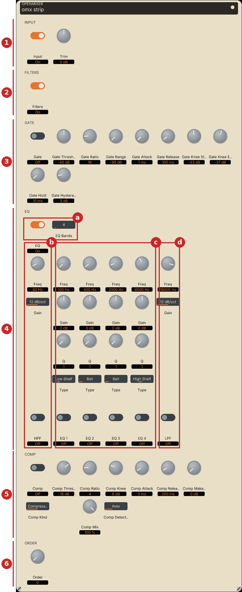
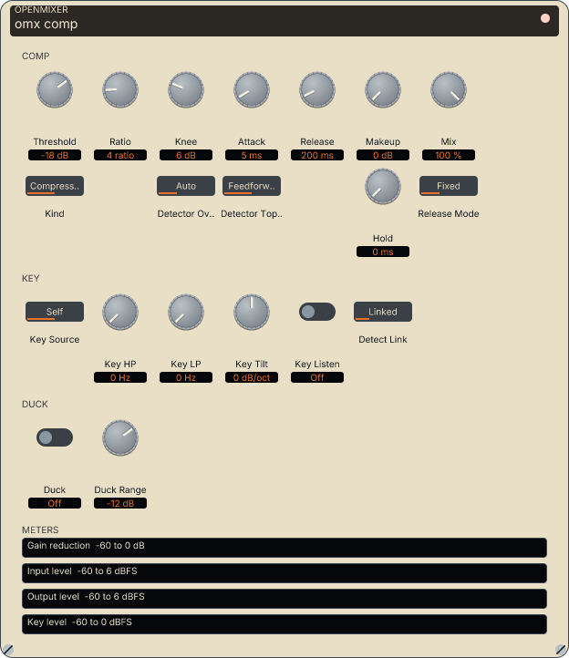
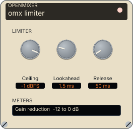
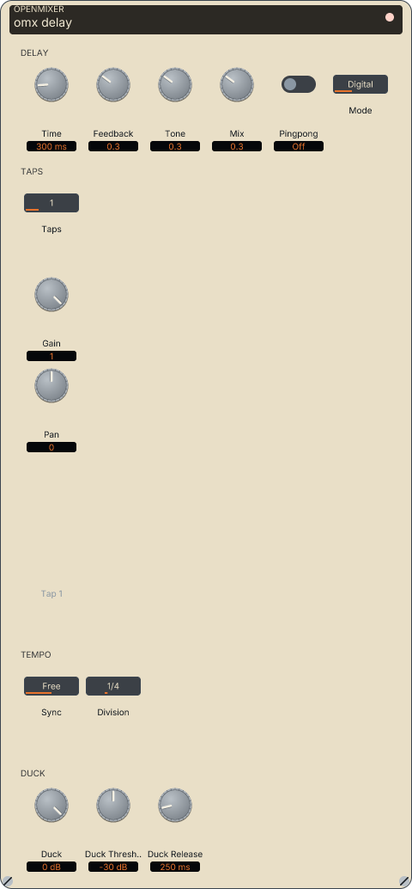
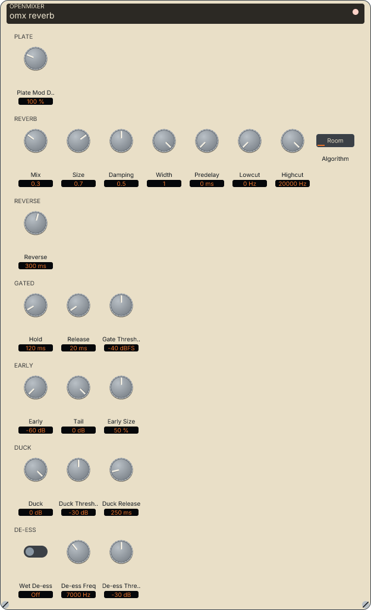
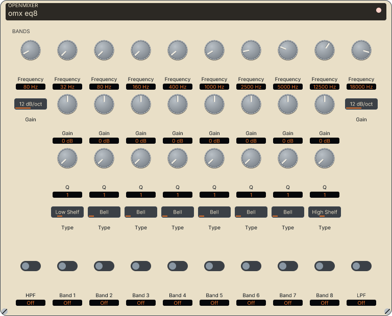

<!-- SPDX-License-Identifier: GPL-3.0-or-later -->
<!-- Copyright (C) 2026 Pau Aliagas <linuxnow@gmail.com> -->

# omx-strip and its MOD GUI

omx-strip is the OpenMixer console's channel strip in one plugin: input trim, high- and low-pass filters, gate, a
parametric EQ and a compressor. This page shows what its MOD GUI looks like and explains each group of controls,
with the units and ranges of the plugin's descriptor. The complete list of its 192 parameters (ids, symbols, flags)
is the generated [parameter page](plugins/omx-strip.md).

The pictures are the screenshot `omx-panel` writes with the MOD GUI, in its default (vintage) look. omx-plugins
ships no MOD GUI file (`make no-modgui`): a host generates it from the plugin's descriptor, and these images are
documentation only, not part of any package. They were made with omx-panel 0.14.0 and omx-plugins 0.19.3:

```
omx-panel modgui --descriptor plugins/omx-strip/omx-strip.descriptor.json --out strip.lv2
# the screenshot is strip.lv2/modgui/screenshot-strip.png
```

## The panel, group by group



The panel has six groups, top to bottom (the red numbers). Each group begins with its own on/off switch, so a stage
you do not need costs nothing. The EQ is drawn as an aligned matrix (letters a to d): one column for each band and
one row for each of its controls, with the high-pass and low-pass filters as the first and last columns, as on the
console.

| Mark | Group | What it is |
|---|---|---|
| 1 | Input | switch and trim |
| 2 | Filters | the switch of the HPF and LPF; their controls are in the EQ matrix (b and d) |
| 3 | Gate | an expander/gate: ten controls |
| 4 | EQ | the EQ's switch, the band count (a) and the matrix of columns (b, c, d) |
| 5 | Comp | compressor or limiter |
| 6 | Order | the order the five stages run in |

The plain screenshot, as the generator wrote it, is [omx-strip-modgui.png](images/omx-strip-modgui.png).

### 1. Input

| Control | Unit | Range (default) | What it does |
|---|---|---|---|
| Input | on/off | on | Switches the stage; off passes the signal untouched. |
| Trim | dB | -24 to 24 (0) | Gain ahead of the other stages. A change ramps to its new value, with no click. |

### 2. Filters, and the filter columns of the EQ matrix

The Filters switch (on by default) enables both filters; each filter also has its own switch, in the matrix, and
both are off at first.

| Control | Unit | Range (default) | What it does |
|---|---|---|---|
| Filters | on/off | on | Switches the stage. |
| HPF (column b, bottom row) | on/off | off | High-pass filter on or off. |
| HPF Freq (column b, Freq row) | Hz | 20 to 1000 (80) | Cut-off frequency of the high-pass. |
| HPF Slope (column b, in the Gain row) | dB/oct | 12 or 24 (12) | Steepness of the high-pass. |
| LPF (column d, bottom row) | on/off | off | Low-pass filter on or off. |
| LPF Freq (column d, Freq row) | Hz | 1000 to 20000 (18000) | Cut-off frequency of the low-pass. |
| LPF Slope (column d, in the Gain row) | dB/oct | 12 or 24 (12) | Steepness of the low-pass. |

### 3. Gate

| Control | Unit | Range (default) | What it does |
|---|---|---|---|
| Gate | on/off | off | Switches the stage. |
| Gate Threshold | dB | -80 to 0 (-40) | Level below which the gate closes. |
| Gate Ratio | : 1 | 1 to 100 (16) | How hard the signal below the threshold is pulled down. |
| Gate Range | dB | -90 to 0 (-90) | The most the gate attenuates when closed. |
| Gate Attack | ms | 0 to 500 (1) | How fast it opens. |
| Gate Release | ms | 0 to 5000 (100) | How fast it closes. |
| Gate Knee Start | dB | -80 to 0 (-43) | Level where the gate starts to act, the lower end of the soft knee. |
| Gate Knee End | dB | -80 to 0 (-37) | Level where it acts fully, the upper end of the soft knee. |
| Gate Hold | ms | 0 to 2000 (10) | Time it stays open after the level drops below the threshold. |
| Gate Hysteresis | dB | 0 to 24 (3) | Extra margin between opening and closing, so a level near the threshold does not chatter. |

### 4. EQ

A parametric EQ of up to 32 bands; the panel draws the bands that run. The top row (a) holds the switch and **EQ
Bands**; below it each column is one band, and the rows are the same for every column.

| Control | Unit | Range (default) | What it does |
|---|---|---|---|
| EQ (a) | on/off | on | Switches the stage. |
| EQ Bands (a) | bands | 1 to 32 (4) | How many bands run, counting from the first. A band past it is not processed, and keeps its settings for when the count reaches it again. |
| EQ n, the bottom row (c) | on/off | off | Switches band n. |
| Type | choice | Bell, Low Shelf, High Shelf, Notch, All-pass 1st, All-pass 2nd | The band's filter shape. At first band 1 is a Low Shelf, bands 2 and 3 are Bells, band 4 is a High Shelf. |
| Freq | Hz | 20 to 20000 | Centre or corner frequency. At first 100, 400, 2000 and 8000 Hz for bands 1 to 4. |
| Gain | dB | -15 to 15 (0) | Boost or cut. |
| Q | | 0.3 to 116 (1) | Width of the band: a higher Q is narrower. |

The matrix has at most 34 columns: HPF, the bands that run (EQ Bands, up to 32), LPF.

### 5. Comp

| Control | Unit | Range (default) | What it does |
|---|---|---|---|
| Comp | on/off | off | Switches the stage. |
| Comp Threshold | dB | -60 to 0 (-18) | Level above which the compressor works. |
| Comp Ratio | : 1 | 1 to 20 (4) | How much the excess over the threshold is reduced. |
| Comp Knee | dB | 0 to 24 (6) | Width of the soft knee around the threshold. |
| Comp Attack | ms | 0.1 to 100 (5) | How fast it reacts to a rise in level. |
| Comp Release | ms | 5 to 3000 (200) | How fast it lets go. |
| Comp Makeup | dB | 0 to 24 (0) | Gain added after the compression. |
| Comp Kind | choice | Compressor, Limiter (Compressor) | A compressor follows the RMS level; a limiter the peak. |
| Comp Mix | % | 0 to 100 (100) | Blend of the compressed signal with the dry one (parallel compression). |
| Comp Detector Oversampling | choice | Auto, Off, 4x (Auto) | Oversampling of the level detector, for true-peak behaviour. While 4x is engaged the strip reports latency. |

### 6. Order

| Control | Unit | Range (default) | What it does |
|---|---|---|---|
| Order | step | 0 to 119 (0) | The order the five stages run in: 0 is the console's own, input > filters > gate > EQ > comp; 1 is input > filters > gate > comp > EQ; and so on in lexicographic order up to 119, comp > EQ > gate > filters > input. |

## Other effects

The same generator draws every omx-plugins effect; a few for comparison.

| Effect | MOD GUI |
|---|---|
| omx comp |  |
| omx limiter |  |
| omx delay |  |
| omx reverb |  |
| omx eq8 |  |
