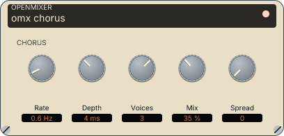

<!-- SPDX-License-Identifier: GPL-3.0-or-later -->
<!-- Copyright (C) 2026 Pau Aliagas <linuxnow@gmail.com> -->
<!-- Generated by tools/params-doc.mjs from the declarations; edit them and run `make params-doc`. -->

# omx chorus

The console's chorus: up to four voices read one modulated delay line, the right leg's sweep offset by the spread, mixed with the dry signal.

- CLAP id: `org.openmixer.chorus`
- LV2 URI: `urn:openmixer:chorus`
- Parameters: 5, plus the host's bypass

## Panel

The panel as a host draws it from the declaration alone, every control at its default (`make panel-images`: omx-panel lays it out and its renderer draws it). Its sections and their controls, in order:

| Section | Controls |
|---|---|
| Chorus | Rate, Depth, Voices, Mix, Spread |

## Audio ports

| Direction | Name | Role | Channels |
|---|---|---|---|
| in | in | main | 2 (stereo) |
| out | out | main | 2 (stereo) |

## Pages

A page is where a host shows a parameter. In LV2 each page is a port group, `pg:group <urn:openmixer:chorus#<symbol>>`, whose `lv2:displayPriority` is the number below (a host that shows the higher first, as Zynthian does, shows the pages in port order). In CLAP each page is the module of its parameters (`clap_param_info.module`), the page labels joined by `/`.

| Page | LV2 group symbol | Priority | CLAP module | Parameters |
|---|---|---|---|---|
| Chorus | `chorus` | 1 | `Chorus` | 5 |

## Parameters

Ids are the order below, 0 to 4; a parameter appended later takes the next id. The bypass's id is its own (below).

| Id | Symbol | Name | Unit | Min | Max | Default | Step or values | Flags | Page (priority) |
|---|---|---|---|---|---|---|---|---|---|
| 0 | `spread` | Spread |  | 0 | 0.5 | 0 | continuous, linear | automatable | Chorus (1) |
| 1 | `rate` | Rate | Hz | 0.05 | 8 | 0.6 | continuous, log | automatable | Chorus (1) |
| 2 | `depth` | Depth | ms | 0 | 12 | 4 | continuous, linear | automatable | Chorus (1) |
| 3 | `voices` | Voices |  | 1 | 4 | 3 | whole steps | automatable | Chorus (1) |
| 4 | `mix` | Mix | % | 0 | 100 | 35 | continuous, linear | automatable | Chorus (1) |

## Bypass

CLAP: the host's bypass, a parameter named Bypass at id 2147418112 (0x7FFF0000) in every plugin, flagged automatable, stepped and bypass; 0 is processing, 1 bypassed. The id never moves when a parameter is appended.
LV2: the port `enabled` (`lv2:designation lv2:enabled`) at index 0, 1 is processing, 0 is bypassed; the output port `latency` at index 1 reports the latency in frames. Both come before the audio and parameter ports in every plugin, so neither moves; a preset or a session names a port by its symbol.
