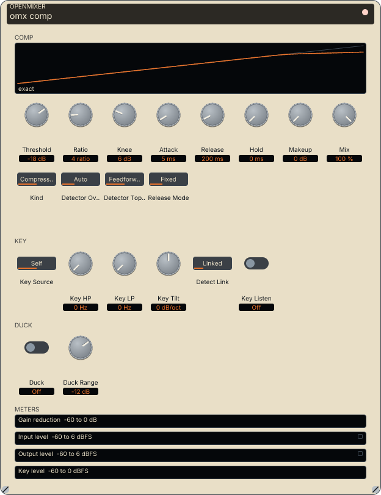

<!-- SPDX-License-Identifier: GPL-3.0-or-later -->
<!-- Copyright (C) 2026 Pau Aliagas <linuxnow@gmail.com> -->
<!-- Generated by tools/params-doc.mjs from the declarations; edit them and run `make params-doc`. -->

# omx comp

The console's compressor: threshold, ratio and knee set how hard it holds the level down, attack and release how fast, with makeup gain and a dry/wet mix. Kind picks the RMS detector (Compressor) or the peak detector (Limiter), and detector oversampling can run the control path at 4x; detector topology has it hear the input (feedforward) or its own output (feedback). Its detector can listen to a key routed to its sidechain input instead, through a high-pass, a low-pass and a tilt, on the louder leg, the mid or the side, with a hold; key listen puts what the detector hears on the output, and duck holds the reduction to a set depth. The DSP is omx-dsp's <omxdsp/fx/omx_comp_instance.h>, the console's own compressor.

- CLAP id: `org.openmixer.comp`
- LV2 URI: `urn:openmixer:comp`
- Parameters: 20, plus the host's bypass

## Panel

The panel as a host draws it from the declaration alone, every control at its default (`make panel-images`: omx-panel lays it out and its renderer draws it). Its sections and their controls, in order:

| Section | Controls |
|---|---|
| Comp | Threshold, Ratio, Knee, Attack, Release, Hold, Makeup, Mix, Kind, Detector Oversampling, Detector Topology, Release Mode |
| Key | Key Source, Key HP, Key LP, Key Tilt, Detect Link, Key Listen |
| Duck | Duck, Duck Range |

## Audio ports

| Direction | Name | Role | Channels |
|---|---|---|---|
| in | in | main | 2 (stereo) |
| in | key | sidechain | 1 (mono) |
| out | out | main | 2 (stereo) |

## Pages

A page is where a host shows a parameter. In LV2 each page is a port group, `pg:group <urn:openmixer:comp#<symbol>>`, whose `lv2:displayPriority` is the number below (a host that shows the higher first, as Zynthian does, shows the pages in port order). In CLAP each page is the module of its parameters (`clap_param_info.module`), the page labels joined by `/`.

| Page | LV2 group symbol | Priority | CLAP module | Parameters |
|---|---|---|---|---|
| Comp | `comp` | 3 | `Comp` | 12 |
| Key | `key` | 2 | `Key` | 6 |
| Duck | `duck` | 1 | `Duck` | 2 |

## Parameters

Ids are the order below, 0 to 19; a parameter appended later takes the next id. The bypass's id is its own (below).

| Id | Symbol | Name | Unit | Min | Max | Default | Step or values | Flags | Page (priority) |
|---|---|---|---|---|---|---|---|---|---|
| 0 | `thresholdDb` | Threshold | dB | -60 | 0 | -18 | whole steps | automatable | Comp (3) |
| 1 | `ratio` | Ratio | ratio | 1 | 20 | 4 | continuous, linear | automatable | Comp (3) |
| 2 | `kneeDb` | Knee | dB | 0 | 24 | 6 | continuous, linear | automatable | Comp (3) |
| 3 | `attackMs` | Attack | ms | 0.1 | 100 | 5 | continuous, linear | automatable | Comp (3) |
| 4 | `releaseMs` | Release | ms | 5 | 3000 | 200 | whole steps | automatable | Comp (3) |
| 5 | `makeupDb` | Makeup | dB | 0 | 24 | 0 | continuous, linear | automatable | Comp (3) |
| 6 | `mixPct` | Mix | % | 0 | 100 | 100 | whole steps | automatable | Comp (3) |
| 7 | `kind` | Kind |  | 0 | 1 | Compressor (0) | 0 Compressor, 1 Limiter | automatable | Comp (3) |
| 8 | `detectorOversampling` | Detector Oversampling |  | 0 | 2 | Auto (0) | 0 Auto, 1 Off, 2 4x | automatable | Comp (3) |
| 9 | `detectorTopology` | Detector Topology |  | 0 | 1 | Feedforward (0) | 0 Feedforward, 1 Feedback | automatable | Comp (3) |
| 10 | `keySource` | Key Source |  | 0 | 1 | Self (0) | 0 Self, 1 Sidechain | automatable | Key (2) |
| 11 | `keyHpHz` | Key HP | Hz | 0 | 2000 | 0 | whole steps | automatable | Key (2) |
| 12 | `keyLpHz` | Key LP | Hz | 0 | 20000 | 0 | whole steps | automatable | Key (2) |
| 13 | `keyTiltDb` | Key Tilt | dB/oct | -6 | 6 | 0 | continuous, linear | automatable | Key (2) |
| 14 | `keyListen` | Key Listen |  | off | on | off | toggle | automatable | Key (2) |
| 15 | `holdMs` | Hold | ms | 0 | 2000 | 0 | whole steps | automatable | Comp (3) |
| 16 | `detectLink` | Detect Link |  | 0 | 3 | Linked (0) | 0 Linked, 1 Mid, 2 Side, 3 Max | automatable | Key (2) |
| 17 | `duck` | Duck |  | off | on | off | toggle | automatable | Duck (1) |
| 18 | `rangeDb` | Duck Range | dB | -40 | 0 | -12 | whole steps | automatable | Duck (1) |
| 19 | `releaseMode` | Release Mode |  | 0 | 2 | Fixed (0) | 0 Fixed, 1 Opto, 2 Auto | automatable | Comp (3) |

## Bypass

CLAP: the host's bypass, a parameter named Bypass at id 2147418112 (0x7FFF0000) in every plugin, flagged automatable, stepped and bypass; 0 is processing, 1 bypassed. The id never moves when a parameter is appended.
LV2: the port `enabled` (`lv2:designation lv2:enabled`) at index 0, 1 is processing, 0 is bypassed; the output port `latency` at index 1 reports the latency in frames. Both come before the audio and parameter ports in every plugin, so neither moves; a preset or a session names a port by its symbol.
