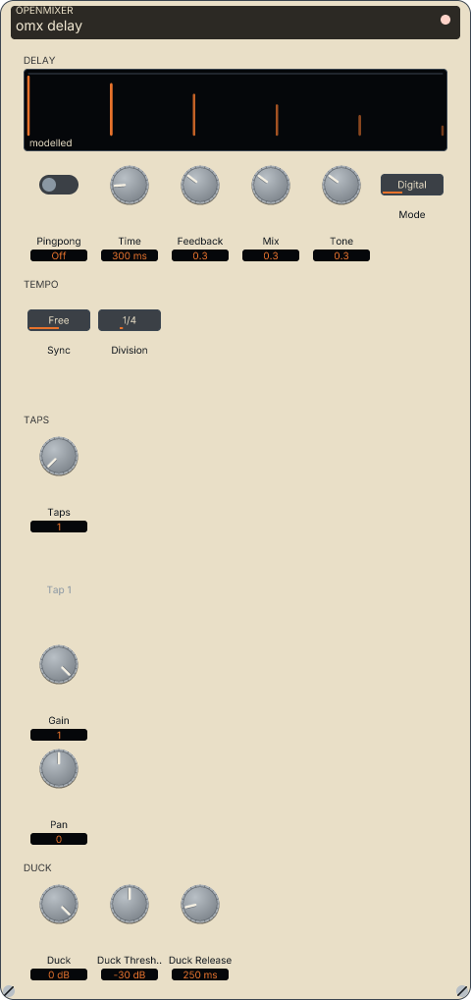

<!-- SPDX-License-Identifier: GPL-3.0-or-later -->
<!-- Copyright (C) 2026 Pau Aliagas <linuxnow@gmail.com> -->
<!-- Generated by tools/params-doc.mjs from the declarations; edit them and run `make params-doc`. -->

# omx delay

The OpenMixer console's stereo delay: one time, free or synced to the host's tempo, feedback through a tone filter, ping-pong, read taps, a tape or analog colour, a wet/dry mix and a duck under the input.

- CLAP id: `org.openmixer.delay`
- LV2 URI: `urn:openmixer:delay`
- Parameters: 23, plus the host's bypass

## Panel

The panel as a host draws it from the declaration alone, every control at its default (`make panel-images`: omx-panel lays it out and its renderer draws it). Its sections and their controls, in order:

| Section | Controls |
|---|---|
| Delay | Pingpong, Time, Feedback, Mix, Tone, Mode |
| Tempo | Sync, Division |
| Taps | Taps, Tap 1 Gain, Tap 1 Pan, Tap 2 Time, Tap 2 Gain, Tap 2 Pan, Tap 3 Time, Tap 3 Gain, Tap 3 Pan, Tap 4 Time, Tap 4 Gain, Tap 4 Pan |
| Duck | Duck, Duck Threshold, Duck Release |

## Audio ports

| Direction | Name | Role | Channels |
|---|---|---|---|
| in | in | main | 2 (stereo) |
| out | out | main | 2 (stereo) |

## Pages

A page is where a host shows a parameter. In LV2 each page is a port group, `pg:group <urn:openmixer:delay#<symbol>>`, whose `lv2:displayPriority` is the number below (a host that shows the higher first, as Zynthian does, shows the pages in port order). In CLAP each page is the module of its parameters (`clap_param_info.module`), the page labels joined by `/`.

| Page | LV2 group symbol | Priority | CLAP module | Parameters |
|---|---|---|---|---|
| Delay | `delay` | 4 | `Delay` | 6 |
| Taps | `taps` | 3 | `Taps` | 12 |
| Tempo | `tempo` | 2 | `Tempo` | 2 |
| Duck | `duck` | 1 | `Duck` | 3 |

## Parameters

Ids are the order below, 0 to 22; a parameter appended later takes the next id. The bypass's id is its own (below).

| Id | Symbol | Name | Unit | Min | Max | Default | Step or values | Flags | Page (priority) |
|---|---|---|---|---|---|---|---|---|---|
| 0 | `fxDelayTime` | Time | ms | 0 | 2000 | 300 | whole steps | automatable | Delay (4) |
| 1 | `fxDelayFeedback` | Feedback |  | 0 | 0.99 | 0.3 | continuous, linear | automatable | Delay (4) |
| 2 | `tone` | Tone |  | 0 | 1 | 0.3 | continuous, linear | automatable | Delay (4) |
| 3 | `mix` | Mix |  | 0 | 1 | 0.3 | continuous, linear | automatable | Delay (4) |
| 4 | `pingpong` | Pingpong |  | off | on | off | toggle | automatable | Delay (4) |
| 5 | `fxDelayTaps` | Taps |  | 1 | 4 | 1 | whole steps | automatable | Taps (3) |
| 6 | `tap0Gain` | Tap 1 Gain |  | 0 | 1 | 1 | continuous, linear | automatable | Taps (3) |
| 7 | `tap0Pan` | Tap 1 Pan |  | -1 | 1 | 0 | continuous, linear | automatable | Taps (3) |
| 8 | `tap1Factor` | Tap 2 Time |  | 0 | 10 | 1/2 (3) | 0 1/4, 1 1/3, 2 3/8, 3 1/2, 4 2/3, 5 3/4, 6 1, 7 4/3, 8 3/2, 9 2, 10 3 | automatable | Taps (3) |
| 9 | `tap1Gain` | Tap 2 Gain |  | 0 | 1 | 0.7 | continuous, linear | automatable | Taps (3) |
| 10 | `tap1Pan` | Tap 2 Pan |  | -1 | 1 | -0.5 | continuous, linear | automatable | Taps (3) |
| 11 | `tap2Factor` | Tap 3 Time |  | 0 | 10 | 3/4 (5) | 0 1/4, 1 1/3, 2 3/8, 3 1/2, 4 2/3, 5 3/4, 6 1, 7 4/3, 8 3/2, 9 2, 10 3 | automatable | Taps (3) |
| 12 | `tap2Gain` | Tap 3 Gain |  | 0 | 1 | 0.5 | continuous, linear | automatable | Taps (3) |
| 13 | `tap2Pan` | Tap 3 Pan |  | -1 | 1 | 0.5 | continuous, linear | automatable | Taps (3) |
| 14 | `tap3Factor` | Tap 4 Time |  | 0 | 10 | 3/2 (8) | 0 1/4, 1 1/3, 2 3/8, 3 1/2, 4 2/3, 5 3/4, 6 1, 7 4/3, 8 3/2, 9 2, 10 3 | automatable | Taps (3) |
| 15 | `tap3Gain` | Tap 4 Gain |  | 0 | 1 | 0.35 | continuous, linear | automatable | Taps (3) |
| 16 | `tap3Pan` | Tap 4 Pan |  | -1 | 1 | 0 | continuous, linear | automatable | Taps (3) |
| 17 | `sync` | Sync |  | 0 | 1 | Free (0) | 0 Free, 1 Tempo | automatable | Tempo (2) |
| 18 | `division` | Division |  | 0 | 17 | 1/4 (6) | 0 1/1, 1 1/1 dotted, 2 1/1 triplet, 3 1/2, 4 1/2 dotted, 5 1/2 triplet, 6 1/4, 7 1/4 dotted, 8 1/4 triplet, 9 1/8, 10 1/8 dotted, 11 1/8 triplet, 12 1/16, 13 1/16 dotted, 14 1/16 triplet, 15 1/32, 16 1/32 dotted, 17 1/32 triplet | automatable | Tempo (2) |
| 19 | `mode` | Mode |  | 0 | 2 | Digital (0) | 0 Digital, 1 Tape, 2 Analog | automatable | Delay (4) |
| 20 | `duckDb` | Duck | dB | -24 | 0 | 0 | continuous, linear | automatable | Duck (1) |
| 21 | `duckThresholdDb` | Duck Threshold | dB | -60 | 0 | -30 | whole steps | automatable | Duck (1) |
| 22 | `duckReleaseMs` | Duck Release | ms | 20 | 2000 | 250 | whole steps | automatable | Duck (1) |

## Bypass

CLAP: the host's bypass, a parameter named Bypass at id 2147418112 (0x7FFF0000) in every plugin, flagged automatable, stepped and bypass; 0 is processing, 1 bypassed. The id never moves when a parameter is appended.
LV2: the port `enabled` (`lv2:designation lv2:enabled`) at index 0, 1 is processing, 0 is bypassed; the output port `latency` at index 1 reports the latency in frames. Both come before the audio and parameter ports in every plugin, so neither moves; a preset or a session names a port by its symbol.
