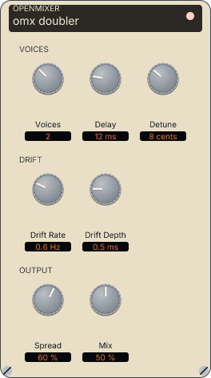

<!-- SPDX-License-Identifier: GPL-3.0-or-later -->
<!-- Copyright (C) 2026 Pau Aliagas <linuxnow@gmail.com> -->
<!-- Generated by tools/params-doc.mjs from the declarations; edit them and run `make params-doc`. -->

# omx doubler

Doubles a voice or an instrument with up to four slightly delayed, detuned and drifting copies spread across the stereo field, the double-tracked sound without a second take.

- CLAP id: `org.openmixer.doubler`
- LV2 URI: `urn:openmixer:doubler`
- Parameters: 7, plus the host's bypass

## Panel

The panel as a host draws it from the declaration alone, every control at its default (`make panel-images`: omx-panel lays it out and its renderer draws it). Its sections and their controls, in order:

| Section | Controls |
|---|---|
| Voices | Voices, Delay, Detune |
| Drift | Drift Rate, Drift Depth |
| Output | Spread, Mix |

## Audio ports

| Direction | Name | Role | Channels |
|---|---|---|---|
| in | in | main | 2 (stereo) |
| out | out | main | 2 (stereo) |

## Pages

A page is where a host shows a parameter. In LV2 each page is a port group, `pg:group <urn:openmixer:doubler#<symbol>>`, whose `lv2:displayPriority` is the number below (a host that shows the higher first, as Zynthian does, shows the pages in port order). In CLAP each page is the module of its parameters (`clap_param_info.module`), the page labels joined by `/`.

| Page | LV2 group symbol | Priority | CLAP module | Parameters |
|---|---|---|---|---|
| Voices | `voices` | 3 | `Voices` | 3 |
| Drift | `drift` | 2 | `Drift` | 2 |
| Output | `output` | 1 | `Output` | 2 |

## Parameters

Ids are the order below, 0 to 6; a parameter appended later takes the next id. The bypass's id is its own (below).

| Id | Symbol | Name | Unit | Min | Max | Default | Step or values | Flags | Page (priority) |
|---|---|---|---|---|---|---|---|---|---|
| 0 | `voices` | Voices |  | 1 | 4 | 2 | whole steps | automatable | Voices (3) |
| 1 | `delayMs` | Delay | ms | 5 | 40 | 12 | continuous, linear | automatable | Voices (3) |
| 2 | `detuneCents` | Detune | cents | 0 | 25 | 8 | continuous, linear | automatable | Voices (3) |
| 3 | `modRateHz` | Drift Rate | Hz | 0.1 | 2 | 0.6 | continuous, log | automatable | Drift (2) |
| 4 | `modDepthMs` | Drift Depth | ms | 0 | 3 | 0.5 | continuous, linear | automatable | Drift (2) |
| 5 | `spreadPct` | Spread | % | 0 | 100 | 60 | whole steps | automatable | Output (1) |
| 6 | `mixPct` | Mix | % | 0 | 100 | 50 | whole steps | automatable | Output (1) |

## Bypass

CLAP: the host's bypass, a parameter named Bypass at id 2147418112 (0x7FFF0000) in every plugin, flagged automatable, stepped and bypass; 0 is processing, 1 bypassed. The id never moves when a parameter is appended.
LV2: the port `enabled` (`lv2:designation lv2:enabled`) at index 0, 1 is processing, 0 is bypassed; the output port `latency` at index 1 reports the latency in frames. Both come before the audio and parameter ports in every plugin, so neither moves; a preset or a session names a port by its symbol.
