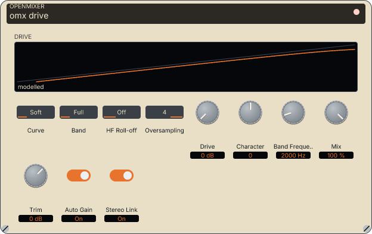

<!-- SPDX-License-Identifier: GPL-3.0-or-later -->
<!-- Copyright (C) 2026 Pau Aliagas <linuxnow@gmail.com> -->
<!-- Generated by tools/params-doc.mjs from the declarations; edit them and run `make params-doc`. -->

# omx drive

The console's drive: one waveshaper (soft, tape, tube or exciter) run inside the console's oversampler, on the full band, the lows, the highs or a tilt, with a wet/dry mix and a trim.

- CLAP id: `org.openmixer.drive`
- LV2 URI: `urn:openmixer:drive`
- Parameters: 11, plus the host's bypass

## Panel

The panel as a host draws it from the declaration alone, every control at its default (`make panel-images`: omx-panel lays it out and its renderer draws it). Its sections and their controls, in order:

| Section | Controls |
|---|---|
| Drive | Curve, Band, HF Roll-off, Oversampling, Drive, Character, Band Frequency, Mix, Trim, Auto Gain, Stereo Link |

## Audio ports

| Direction | Name | Role | Channels |
|---|---|---|---|
| in | in | main | 2 (stereo) |
| out | out | main | 2 (stereo) |

## Pages

A page is where a host shows a parameter. In LV2 each page is a port group, `pg:group <urn:openmixer:drive#<symbol>>`, whose `lv2:displayPriority` is the number below (a host that shows the higher first, as Zynthian does, shows the pages in port order). In CLAP each page is the module of its parameters (`clap_param_info.module`), the page labels joined by `/`.

| Page | LV2 group symbol | Priority | CLAP module | Parameters |
|---|---|---|---|---|
| Drive | `drive` | 1 | `Drive` | 11 |

## Parameters

Ids are the order below, 0 to 10; a parameter appended later takes the next id. The bypass's id is its own (below).

| Id | Symbol | Name | Unit | Min | Max | Default | Step or values | Flags | Page (priority) |
|---|---|---|---|---|---|---|---|---|---|
| 0 | `amount` | Drive | dB | 0 | 36 | 0 | continuous, linear | automatable | Drive (1) |
| 1 | `character` | Character |  | -1 | 1 | 0 | continuous, linear | automatable | Drive (1) |
| 2 | `bandFreq` | Band Frequency | Hz | 20 | 20000 | 2000 | whole steps | automatable | Drive (1) |
| 3 | `mix` | Mix | % | 0 | 100 | 100 | continuous, linear | automatable | Drive (1) |
| 4 | `trim` | Trim | dB | -24 | 12 | 0 | continuous, linear | automatable | Drive (1) |
| 5 | `curve` | Curve |  | 0 | 3 | Soft (0) | 0 Soft, 1 Tape, 2 Tube, 3 Exciter | automatable | Drive (1) |
| 6 | `band` | Band |  | 0 | 3 | Full (0) | 0 Full, 1 Low, 2 High, 3 Tilt | automatable | Drive (1) |
| 7 | `autoGain` | Auto Gain |  | off | on | on | toggle | automatable | Drive (1) |
| 8 | `stereoLink` | Stereo Link |  | off | on | on | toggle | automatable | Drive (1) |
| 9 | `hfRolloff` | HF Roll-off |  | 0 | 2 | Off (0) | 0 Off, 1 12 kHz, 2 16 kHz | automatable | Drive (1) |
| 10 | `oversample` | Oversampling |  | 1 | 4 | 4 (4) | 1 1, 2 2, 4 4 | automatable | Drive (1) |

## Bypass

CLAP: the host's bypass, a parameter named Bypass at id 2147418112 (0x7FFF0000) in every plugin, flagged automatable, stepped and bypass; 0 is processing, 1 bypassed. The id never moves when a parameter is appended.
LV2: the port `enabled` (`lv2:designation lv2:enabled`) at index 0, 1 is processing, 0 is bypassed; the output port `latency` at index 1 reports the latency in frames. Both come before the audio and parameter ports in every plugin, so neither moves; a preset or a session names a port by its symbol.
