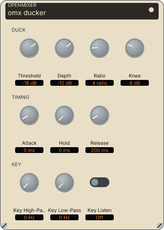

<!-- SPDX-License-Identifier: GPL-3.0-or-later -->
<!-- Copyright (C) 2026 Pau Aliagas <linuxnow@gmail.com> -->
<!-- Generated by tools/params-doc.mjs from the declarations; edit them and run `make params-doc`. -->

# omx ducker

Pulls the programme down while a key is heard, music under a voice, by a set depth with attack, hold and release, the console ducker.

- CLAP id: `org.openmixer.ducker`
- LV2 URI: `urn:openmixer:ducker`
- Parameters: 10, plus the host's bypass

## Panel

The panel as a host draws it from the declaration alone, every control at its default (`make panel-images`: omx-panel lays it out and its renderer draws it). Its sections and their controls, in order:

| Section | Controls |
|---|---|
| Duck | Threshold, Depth, Ratio, Knee |
| Timing | Attack, Hold, Release |
| Key | Key High-Pass, Key Low-Pass, Key Listen |

## Audio ports

| Direction | Name | Role | Channels |
|---|---|---|---|
| in | in | main | 2 (stereo) |
| in | key | sidechain | 1 (mono) |
| out | out | main | 2 (stereo) |

## Pages

A page is where a host shows a parameter. In LV2 each page is a port group, `pg:group <urn:openmixer:ducker#<symbol>>`, whose `lv2:displayPriority` is the number below (a host that shows the higher first, as Zynthian does, shows the pages in port order). In CLAP each page is the module of its parameters (`clap_param_info.module`), the page labels joined by `/`.

| Page | LV2 group symbol | Priority | CLAP module | Parameters |
|---|---|---|---|---|
| Duck | `duck` | 3 | `Duck` | 4 |
| Timing | `timing` | 2 | `Timing` | 3 |
| Key | `key` | 1 | `Key` | 3 |

## Parameters

Ids are the order below, 0 to 9; a parameter appended later takes the next id. The bypass's id is its own (below).

| Id | Symbol | Name | Unit | Min | Max | Default | Step or values | Flags | Page (priority) |
|---|---|---|---|---|---|---|---|---|---|
| 0 | `thresholdDb` | Threshold | dB | -60 | 0 | -18 | whole steps | automatable | Duck (3) |
| 1 | `rangeDb` | Depth | dB | -40 | 0 | -12 | whole steps | automatable | Duck (3) |
| 2 | `attackMs` | Attack | ms | 0.1 | 100 | 5 | continuous, linear | automatable | Timing (2) |
| 3 | `holdMs` | Hold | ms | 0 | 2000 | 0 | whole steps | automatable | Timing (2) |
| 4 | `releaseMs` | Release | ms | 5 | 3000 | 200 | whole steps | automatable | Timing (2) |
| 5 | `ratio` | Ratio | ratio | 1 | 20 | 4 | continuous, linear | automatable | Duck (3) |
| 6 | `kneeDb` | Knee | dB | 0 | 24 | 6 | continuous, linear | automatable | Duck (3) |
| 7 | `keyHpHz` | Key High-Pass | Hz | 0 | 2000 | 0 | whole steps | automatable | Key (1) |
| 8 | `keyLpHz` | Key Low-Pass | Hz | 0 | 20000 | 0 | whole steps | automatable | Key (1) |
| 9 | `keyListen` | Key Listen |  | off | on | off | toggle | automatable | Key (1) |

## Bypass

CLAP: the host's bypass, a parameter named Bypass at id 2147418112 (0x7FFF0000) in every plugin, flagged automatable, stepped and bypass; 0 is processing, 1 bypassed. The id never moves when a parameter is appended.
LV2: the port `enabled` (`lv2:designation lv2:enabled`) at index 0, 1 is processing, 0 is bypassed; the output port `latency` at index 1 reports the latency in frames. Both come before the audio and parameter ports in every plugin, so neither moves; a preset or a session names a port by its symbol.
