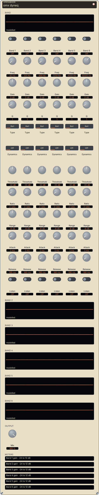

<!-- SPDX-License-Identifier: GPL-3.0-or-later -->
<!-- Copyright (C) 2026 Pau Aliagas <linuxnow@gmail.com> -->
<!-- Generated by tools/params-doc.mjs from the declarations; edit them and run `make params-doc`. -->

# omx dyneq

A six-band dynamic EQ: each band is an EQ bell or shelf whose gain also moves with the level of its own band, cutting above a threshold (down) or lifting below it (up), held to a range, so a harsh or boomy band is tamed only while it is too loud.

- CLAP id: `org.openmixer.dyneq`
- LV2 URI: `urn:openmixer:dyneq`
- Parameters: 73, plus the host's bypass

## Panel

The panel as a host draws it from the declaration alone, every control at its default (`make panel-images`: omx-panel lays it out and its renderer draws it). Its sections and their controls, in order:

| Section | Controls |
|---|---|
| Band 1 | Band 1 On, Band 1 Type, Band 1 Freq, Band 1 Gain, Band 1 Q, Band 1 Dynamics, Band 1 Threshold, Band 1 Ratio, Band 1 Range, Band 1 Attack, Band 1 Release, Band 1 Listen |
| Band 2 | Band 2 On, Band 2 Type, Band 2 Freq, Band 2 Gain, Band 2 Q, Band 2 Dynamics, Band 2 Threshold, Band 2 Ratio, Band 2 Range, Band 2 Attack, Band 2 Release, Band 2 Listen |
| Band 3 | Band 3 On, Band 3 Type, Band 3 Freq, Band 3 Gain, Band 3 Q, Band 3 Dynamics, Band 3 Threshold, Band 3 Ratio, Band 3 Range, Band 3 Attack, Band 3 Release, Band 3 Listen |
| Band 4 | Band 4 On, Band 4 Type, Band 4 Freq, Band 4 Gain, Band 4 Q, Band 4 Dynamics, Band 4 Threshold, Band 4 Ratio, Band 4 Range, Band 4 Attack, Band 4 Release, Band 4 Listen |
| Band 5 | Band 5 On, Band 5 Type, Band 5 Freq, Band 5 Gain, Band 5 Q, Band 5 Dynamics, Band 5 Threshold, Band 5 Ratio, Band 5 Range, Band 5 Attack, Band 5 Release, Band 5 Listen |
| Band 6 | Band 6 On, Band 6 Type, Band 6 Freq, Band 6 Gain, Band 6 Q, Band 6 Dynamics, Band 6 Threshold, Band 6 Ratio, Band 6 Range, Band 6 Attack, Band 6 Release, Band 6 Listen |
| Output | Mix |

## Audio ports

| Direction | Name | Role | Channels |
|---|---|---|---|
| in | in | main | 2 (stereo) |
| out | out | main | 2 (stereo) |

## Pages

A page is where a host shows a parameter. In LV2 each page is a port group, `pg:group <urn:openmixer:dyneq#<symbol>>`, whose `lv2:displayPriority` is the number below (a host that shows the higher first, as Zynthian does, shows the pages in port order). In CLAP each page is the module of its parameters (`clap_param_info.module`), the page labels joined by `/`.

| Page | LV2 group symbol | Priority | CLAP module | Parameters |
|---|---|---|---|---|
| Band 1 | `band1` | 7 | `Band 1` | 12 |
| Band 2 | `band2` | 6 | `Band 2` | 12 |
| Band 3 | `band3` | 5 | `Band 3` | 12 |
| Band 4 | `band4` | 4 | `Band 4` | 12 |
| Band 5 | `band5` | 3 | `Band 5` | 12 |
| Band 6 | `band6` | 2 | `Band 6` | 12 |
| Output | `output` | 1 | `Output` | 1 |

## Parameters

Ids are the order below, 0 to 72; a parameter appended later takes the next id. The bypass's id is its own (below).

| Id | Symbol | Name | Unit | Min | Max | Default | Step or values | Flags | Page (priority) |
|---|---|---|---|---|---|---|---|---|---|
| 0 | `bandOn1` | Band 1 On |  | off | on | off | toggle | automatable | Band 1 (7) |
| 1 | `bandOn2` | Band 2 On |  | off | on | off | toggle | automatable | Band 2 (6) |
| 2 | `bandOn3` | Band 3 On |  | off | on | off | toggle | automatable | Band 3 (5) |
| 3 | `bandOn4` | Band 4 On |  | off | on | off | toggle | automatable | Band 4 (4) |
| 4 | `bandOn5` | Band 5 On |  | off | on | off | toggle | automatable | Band 5 (3) |
| 5 | `bandOn6` | Band 6 On |  | off | on | off | toggle | automatable | Band 6 (2) |
| 6 | `bandType1` | Band 1 Type |  | 0 | 2 | Bell (0) | 0 Bell, 1 Low Shelf, 2 High Shelf | automatable | Band 1 (7) |
| 7 | `bandType2` | Band 2 Type |  | 0 | 2 | Bell (0) | 0 Bell, 1 Low Shelf, 2 High Shelf | automatable | Band 2 (6) |
| 8 | `bandType3` | Band 3 Type |  | 0 | 2 | Bell (0) | 0 Bell, 1 Low Shelf, 2 High Shelf | automatable | Band 3 (5) |
| 9 | `bandType4` | Band 4 Type |  | 0 | 2 | Bell (0) | 0 Bell, 1 Low Shelf, 2 High Shelf | automatable | Band 4 (4) |
| 10 | `bandType5` | Band 5 Type |  | 0 | 2 | Bell (0) | 0 Bell, 1 Low Shelf, 2 High Shelf | automatable | Band 5 (3) |
| 11 | `bandType6` | Band 6 Type |  | 0 | 2 | Bell (0) | 0 Bell, 1 Low Shelf, 2 High Shelf | automatable | Band 6 (2) |
| 12 | `freq1` | Band 1 Freq | Hz | 20 | 20000 | 40 | whole steps | automatable | Band 1 (7) |
| 13 | `freq2` | Band 2 Freq | Hz | 20 | 20000 | 125 | whole steps | automatable | Band 2 (6) |
| 14 | `freq3` | Band 3 Freq | Hz | 20 | 20000 | 400 | whole steps | automatable | Band 3 (5) |
| 15 | `freq4` | Band 4 Freq | Hz | 20 | 20000 | 1250 | whole steps | automatable | Band 4 (4) |
| 16 | `freq5` | Band 5 Freq | Hz | 20 | 20000 | 4000 | whole steps | automatable | Band 5 (3) |
| 17 | `freq6` | Band 6 Freq | Hz | 20 | 20000 | 12500 | whole steps | automatable | Band 6 (2) |
| 18 | `gain1` | Band 1 Gain | dB | -15 | 15 | 0 | continuous, linear | automatable | Band 1 (7) |
| 19 | `gain2` | Band 2 Gain | dB | -15 | 15 | 0 | continuous, linear | automatable | Band 2 (6) |
| 20 | `gain3` | Band 3 Gain | dB | -15 | 15 | 0 | continuous, linear | automatable | Band 3 (5) |
| 21 | `gain4` | Band 4 Gain | dB | -15 | 15 | 0 | continuous, linear | automatable | Band 4 (4) |
| 22 | `gain5` | Band 5 Gain | dB | -15 | 15 | 0 | continuous, linear | automatable | Band 5 (3) |
| 23 | `gain6` | Band 6 Gain | dB | -15 | 15 | 0 | continuous, linear | automatable | Band 6 (2) |
| 24 | `q1` | Band 1 Q |  | 0.3 | 8 | 1 | continuous, linear | automatable | Band 1 (7) |
| 25 | `q2` | Band 2 Q |  | 0.3 | 8 | 1 | continuous, linear | automatable | Band 2 (6) |
| 26 | `q3` | Band 3 Q |  | 0.3 | 8 | 1 | continuous, linear | automatable | Band 3 (5) |
| 27 | `q4` | Band 4 Q |  | 0.3 | 8 | 1 | continuous, linear | automatable | Band 4 (4) |
| 28 | `q5` | Band 5 Q |  | 0.3 | 8 | 1 | continuous, linear | automatable | Band 5 (3) |
| 29 | `q6` | Band 6 Q |  | 0.3 | 8 | 1 | continuous, linear | automatable | Band 6 (2) |
| 30 | `dynMode1` | Band 1 Dynamics |  | 0 | 2 | Off (0) | 0 Off, 1 Down, 2 Up | automatable | Band 1 (7) |
| 31 | `dynMode2` | Band 2 Dynamics |  | 0 | 2 | Off (0) | 0 Off, 1 Down, 2 Up | automatable | Band 2 (6) |
| 32 | `dynMode3` | Band 3 Dynamics |  | 0 | 2 | Off (0) | 0 Off, 1 Down, 2 Up | automatable | Band 3 (5) |
| 33 | `dynMode4` | Band 4 Dynamics |  | 0 | 2 | Off (0) | 0 Off, 1 Down, 2 Up | automatable | Band 4 (4) |
| 34 | `dynMode5` | Band 5 Dynamics |  | 0 | 2 | Off (0) | 0 Off, 1 Down, 2 Up | automatable | Band 5 (3) |
| 35 | `dynMode6` | Band 6 Dynamics |  | 0 | 2 | Off (0) | 0 Off, 1 Down, 2 Up | automatable | Band 6 (2) |
| 36 | `threshold1` | Band 1 Threshold | dB | -60 | 0 | -30 | continuous, linear | automatable | Band 1 (7) |
| 37 | `threshold2` | Band 2 Threshold | dB | -60 | 0 | -30 | continuous, linear | automatable | Band 2 (6) |
| 38 | `threshold3` | Band 3 Threshold | dB | -60 | 0 | -30 | continuous, linear | automatable | Band 3 (5) |
| 39 | `threshold4` | Band 4 Threshold | dB | -60 | 0 | -30 | continuous, linear | automatable | Band 4 (4) |
| 40 | `threshold5` | Band 5 Threshold | dB | -60 | 0 | -30 | continuous, linear | automatable | Band 5 (3) |
| 41 | `threshold6` | Band 6 Threshold | dB | -60 | 0 | -30 | continuous, linear | automatable | Band 6 (2) |
| 42 | `ratio1` | Band 1 Ratio | ratio | 1 | 20 | 2 | continuous, linear | automatable | Band 1 (7) |
| 43 | `ratio2` | Band 2 Ratio | ratio | 1 | 20 | 2 | continuous, linear | automatable | Band 2 (6) |
| 44 | `ratio3` | Band 3 Ratio | ratio | 1 | 20 | 2 | continuous, linear | automatable | Band 3 (5) |
| 45 | `ratio4` | Band 4 Ratio | ratio | 1 | 20 | 2 | continuous, linear | automatable | Band 4 (4) |
| 46 | `ratio5` | Band 5 Ratio | ratio | 1 | 20 | 2 | continuous, linear | automatable | Band 5 (3) |
| 47 | `ratio6` | Band 6 Ratio | ratio | 1 | 20 | 2 | continuous, linear | automatable | Band 6 (2) |
| 48 | `range1` | Band 1 Range | dB | -24 | 12 | -6 | continuous, linear | automatable | Band 1 (7) |
| 49 | `range2` | Band 2 Range | dB | -24 | 12 | -6 | continuous, linear | automatable | Band 2 (6) |
| 50 | `range3` | Band 3 Range | dB | -24 | 12 | -6 | continuous, linear | automatable | Band 3 (5) |
| 51 | `range4` | Band 4 Range | dB | -24 | 12 | -6 | continuous, linear | automatable | Band 4 (4) |
| 52 | `range5` | Band 5 Range | dB | -24 | 12 | -6 | continuous, linear | automatable | Band 5 (3) |
| 53 | `range6` | Band 6 Range | dB | -24 | 12 | -6 | continuous, linear | automatable | Band 6 (2) |
| 54 | `attack1` | Band 1 Attack | ms | 0.5 | 100 | 5 | continuous, linear | automatable | Band 1 (7) |
| 55 | `attack2` | Band 2 Attack | ms | 0.5 | 100 | 5 | continuous, linear | automatable | Band 2 (6) |
| 56 | `attack3` | Band 3 Attack | ms | 0.5 | 100 | 5 | continuous, linear | automatable | Band 3 (5) |
| 57 | `attack4` | Band 4 Attack | ms | 0.5 | 100 | 5 | continuous, linear | automatable | Band 4 (4) |
| 58 | `attack5` | Band 5 Attack | ms | 0.5 | 100 | 5 | continuous, linear | automatable | Band 5 (3) |
| 59 | `attack6` | Band 6 Attack | ms | 0.5 | 100 | 5 | continuous, linear | automatable | Band 6 (2) |
| 60 | `release1` | Band 1 Release | ms | 5 | 3000 | 100 | whole steps | automatable | Band 1 (7) |
| 61 | `release2` | Band 2 Release | ms | 5 | 3000 | 100 | whole steps | automatable | Band 2 (6) |
| 62 | `release3` | Band 3 Release | ms | 5 | 3000 | 100 | whole steps | automatable | Band 3 (5) |
| 63 | `release4` | Band 4 Release | ms | 5 | 3000 | 100 | whole steps | automatable | Band 4 (4) |
| 64 | `release5` | Band 5 Release | ms | 5 | 3000 | 100 | whole steps | automatable | Band 5 (3) |
| 65 | `release6` | Band 6 Release | ms | 5 | 3000 | 100 | whole steps | automatable | Band 6 (2) |
| 66 | `listen1` | Band 1 Listen |  | off | on | off | toggle | automatable | Band 1 (7) |
| 67 | `listen2` | Band 2 Listen |  | off | on | off | toggle | automatable | Band 2 (6) |
| 68 | `listen3` | Band 3 Listen |  | off | on | off | toggle | automatable | Band 3 (5) |
| 69 | `listen4` | Band 4 Listen |  | off | on | off | toggle | automatable | Band 4 (4) |
| 70 | `listen5` | Band 5 Listen |  | off | on | off | toggle | automatable | Band 5 (3) |
| 71 | `listen6` | Band 6 Listen |  | off | on | off | toggle | automatable | Band 6 (2) |
| 72 | `mixPct` | Mix | % | 0 | 100 | 100 | whole steps | automatable | Output (1) |

## Bypass

CLAP: the host's bypass, a parameter named Bypass at id 2147418112 (0x7FFF0000) in every plugin, flagged automatable, stepped and bypass; 0 is processing, 1 bypassed. The id never moves when a parameter is appended.
LV2: the port `enabled` (`lv2:designation lv2:enabled`) at index 0, 1 is processing, 0 is bypassed; the output port `latency` at index 1 reports the latency in frames. Both come before the audio and parameter ports in every plugin, so neither moves; a preset or a session names a port by its symbol.
