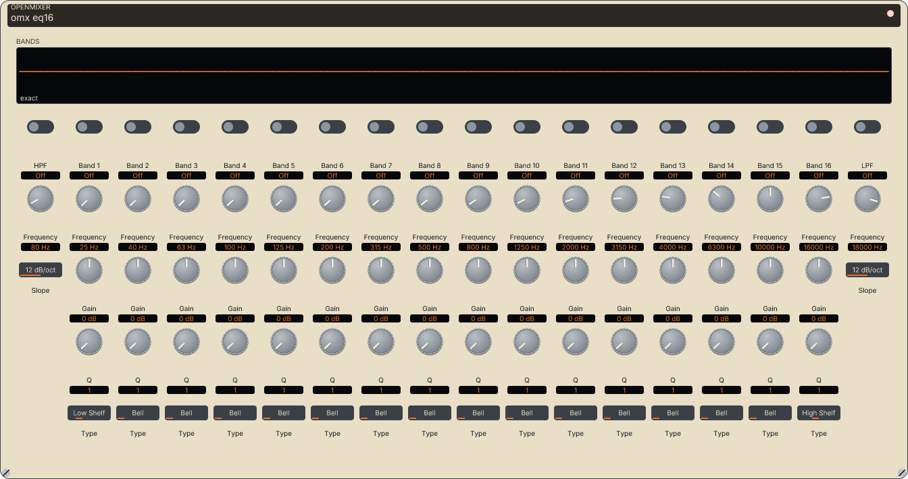

<!-- SPDX-License-Identifier: GPL-3.0-or-later -->
<!-- Copyright (C) 2026 Pau Aliagas <linuxnow@gmail.com> -->
<!-- Generated by tools/params-doc.mjs from the declarations; edit them and run `make params-doc`. -->

# omx eq16

The OpenMixer console's channel EQ, 16-band form: 16 parametric bands (bell, shelves, notch, all-pass) and a high-pass and a low-pass filter at 12 or 24 dB/oct, stereo, zero latency; every band ships off, so a racked instance is a wire.

- CLAP id: `org.openmixer.eq16`
- LV2 URI: `urn:openmixer:eq16`
- Parameters: 86, plus the host's bypass

## Panel

The panel as a host draws it from the declaration alone, every control at its default (`make panel-images`: omx-panel lays it out and its renderer draws it). Its sections and their controls, in order:

| Section | Controls |
|---|---|
| Bands | on, type, freq, gain, q |
| HPF | HPF On, HPF Slope, HPF Frequency |
| LPF | LPF On, LPF Slope, LPF Frequency |

## Audio ports

| Direction | Name | Role | Channels |
|---|---|---|---|
| in | in | main | 2 (stereo) |
| out | out | main | 2 (stereo) |

## Pages

A page is where a host shows a parameter. In LV2 each page is a port group, `pg:group <urn:openmixer:eq16#<symbol>>`, whose `lv2:displayPriority` is the number below (a host that shows the higher first, as Zynthian does, shows the pages in port order). In CLAP each page is the module of its parameters (`clap_param_info.module`), the page labels joined by `/`.

| Page | LV2 group symbol | Priority | CLAP module | Parameters |
|---|---|---|---|---|
| HPF | `hpf` | 18 | `HPF` | 3 |
| LPF | `lpf` | 17 | `LPF` | 3 |
| Bands / Band 1 | `band1` | 16 | `Bands/Band 1` | 5 |
| Bands / Band 2 | `band2` | 15 | `Bands/Band 2` | 5 |
| Bands / Band 3 | `band3` | 14 | `Bands/Band 3` | 5 |
| Bands / Band 4 | `band4` | 13 | `Bands/Band 4` | 5 |
| Bands / Band 5 | `band5` | 12 | `Bands/Band 5` | 5 |
| Bands / Band 6 | `band6` | 11 | `Bands/Band 6` | 5 |
| Bands / Band 7 | `band7` | 10 | `Bands/Band 7` | 5 |
| Bands / Band 8 | `band8` | 9 | `Bands/Band 8` | 5 |
| Bands / Band 9 | `band9` | 8 | `Bands/Band 9` | 5 |
| Bands / Band 10 | `band10` | 7 | `Bands/Band 10` | 5 |
| Bands / Band 11 | `band11` | 6 | `Bands/Band 11` | 5 |
| Bands / Band 12 | `band12` | 5 | `Bands/Band 12` | 5 |
| Bands / Band 13 | `band13` | 4 | `Bands/Band 13` | 5 |
| Bands / Band 14 | `band14` | 3 | `Bands/Band 14` | 5 |
| Bands / Band 15 | `band15` | 2 | `Bands/Band 15` | 5 |
| Bands / Band 16 | `band16` | 1 | `Bands/Band 16` | 5 |

## Parameters

Ids are the order below, 0 to 85; a parameter appended later takes the next id. The bypass's id is its own (below).

| Id | Symbol | Name | Unit | Min | Max | Default | Step or values | Flags | Page (priority) |
|---|---|---|---|---|---|---|---|---|---|
| 0 | `hpf_on` | HPF On |  | off | on | off | toggle | automatable | HPF (18) |
| 1 | `hpf_freq` | HPF Frequency | Hz | 20 | 1000 | 80 | whole steps | automatable | HPF (18) |
| 2 | `hpf_slope` | HPF Slope |  | 12 | 24 | 12 dB/oct (12) | 12 12 dB/oct, 24 24 dB/oct | automatable | HPF (18) |
| 3 | `lpf_on` | LPF On |  | off | on | off | toggle | automatable | LPF (17) |
| 4 | `lpf_freq` | LPF Frequency | Hz | 1000 | 20000 | 18000 | whole steps | automatable | LPF (17) |
| 5 | `lpf_slope` | LPF Slope |  | 12 | 24 | 12 dB/oct (12) | 12 12 dB/oct, 24 24 dB/oct | automatable | LPF (17) |
| 6 | `b1_type` | Band 1 Type |  | 0 | 5 | Low Shelf (1) | 0 Bell, 1 Low Shelf, 2 High Shelf, 3 Notch, 4 All-pass 1st, 5 All-pass 2nd | automatable | Bands / Band 1 (16) |
| 7 | `b1_freq` | Band 1 Frequency | Hz | 20 | 20000 | 25 | whole steps | automatable | Bands / Band 1 (16) |
| 8 | `b1_gain` | Band 1 Gain | dB | -15 | 15 | 0 | continuous, linear | automatable | Bands / Band 1 (16) |
| 9 | `b1_q` | Band 1 Q |  | 0.3 | 116 | 1 | continuous, linear | automatable | Bands / Band 1 (16) |
| 10 | `b1_on` | Band 1 On |  | off | on | off | toggle | automatable | Bands / Band 1 (16) |
| 11 | `b2_type` | Band 2 Type |  | 0 | 5 | Bell (0) | 0 Bell, 1 Low Shelf, 2 High Shelf, 3 Notch, 4 All-pass 1st, 5 All-pass 2nd | automatable | Bands / Band 2 (15) |
| 12 | `b2_freq` | Band 2 Frequency | Hz | 20 | 20000 | 40 | whole steps | automatable | Bands / Band 2 (15) |
| 13 | `b2_gain` | Band 2 Gain | dB | -15 | 15 | 0 | continuous, linear | automatable | Bands / Band 2 (15) |
| 14 | `b2_q` | Band 2 Q |  | 0.3 | 116 | 1 | continuous, linear | automatable | Bands / Band 2 (15) |
| 15 | `b2_on` | Band 2 On |  | off | on | off | toggle | automatable | Bands / Band 2 (15) |
| 16 | `b3_type` | Band 3 Type |  | 0 | 5 | Bell (0) | 0 Bell, 1 Low Shelf, 2 High Shelf, 3 Notch, 4 All-pass 1st, 5 All-pass 2nd | automatable | Bands / Band 3 (14) |
| 17 | `b3_freq` | Band 3 Frequency | Hz | 20 | 20000 | 63 | whole steps | automatable | Bands / Band 3 (14) |
| 18 | `b3_gain` | Band 3 Gain | dB | -15 | 15 | 0 | continuous, linear | automatable | Bands / Band 3 (14) |
| 19 | `b3_q` | Band 3 Q |  | 0.3 | 116 | 1 | continuous, linear | automatable | Bands / Band 3 (14) |
| 20 | `b3_on` | Band 3 On |  | off | on | off | toggle | automatable | Bands / Band 3 (14) |
| 21 | `b4_type` | Band 4 Type |  | 0 | 5 | Bell (0) | 0 Bell, 1 Low Shelf, 2 High Shelf, 3 Notch, 4 All-pass 1st, 5 All-pass 2nd | automatable | Bands / Band 4 (13) |
| 22 | `b4_freq` | Band 4 Frequency | Hz | 20 | 20000 | 100 | whole steps | automatable | Bands / Band 4 (13) |
| 23 | `b4_gain` | Band 4 Gain | dB | -15 | 15 | 0 | continuous, linear | automatable | Bands / Band 4 (13) |
| 24 | `b4_q` | Band 4 Q |  | 0.3 | 116 | 1 | continuous, linear | automatable | Bands / Band 4 (13) |
| 25 | `b4_on` | Band 4 On |  | off | on | off | toggle | automatable | Bands / Band 4 (13) |
| 26 | `b5_type` | Band 5 Type |  | 0 | 5 | Bell (0) | 0 Bell, 1 Low Shelf, 2 High Shelf, 3 Notch, 4 All-pass 1st, 5 All-pass 2nd | automatable | Bands / Band 5 (12) |
| 27 | `b5_freq` | Band 5 Frequency | Hz | 20 | 20000 | 125 | whole steps | automatable | Bands / Band 5 (12) |
| 28 | `b5_gain` | Band 5 Gain | dB | -15 | 15 | 0 | continuous, linear | automatable | Bands / Band 5 (12) |
| 29 | `b5_q` | Band 5 Q |  | 0.3 | 116 | 1 | continuous, linear | automatable | Bands / Band 5 (12) |
| 30 | `b5_on` | Band 5 On |  | off | on | off | toggle | automatable | Bands / Band 5 (12) |
| 31 | `b6_type` | Band 6 Type |  | 0 | 5 | Bell (0) | 0 Bell, 1 Low Shelf, 2 High Shelf, 3 Notch, 4 All-pass 1st, 5 All-pass 2nd | automatable | Bands / Band 6 (11) |
| 32 | `b6_freq` | Band 6 Frequency | Hz | 20 | 20000 | 200 | whole steps | automatable | Bands / Band 6 (11) |
| 33 | `b6_gain` | Band 6 Gain | dB | -15 | 15 | 0 | continuous, linear | automatable | Bands / Band 6 (11) |
| 34 | `b6_q` | Band 6 Q |  | 0.3 | 116 | 1 | continuous, linear | automatable | Bands / Band 6 (11) |
| 35 | `b6_on` | Band 6 On |  | off | on | off | toggle | automatable | Bands / Band 6 (11) |
| 36 | `b7_type` | Band 7 Type |  | 0 | 5 | Bell (0) | 0 Bell, 1 Low Shelf, 2 High Shelf, 3 Notch, 4 All-pass 1st, 5 All-pass 2nd | automatable | Bands / Band 7 (10) |
| 37 | `b7_freq` | Band 7 Frequency | Hz | 20 | 20000 | 315 | whole steps | automatable | Bands / Band 7 (10) |
| 38 | `b7_gain` | Band 7 Gain | dB | -15 | 15 | 0 | continuous, linear | automatable | Bands / Band 7 (10) |
| 39 | `b7_q` | Band 7 Q |  | 0.3 | 116 | 1 | continuous, linear | automatable | Bands / Band 7 (10) |
| 40 | `b7_on` | Band 7 On |  | off | on | off | toggle | automatable | Bands / Band 7 (10) |
| 41 | `b8_type` | Band 8 Type |  | 0 | 5 | Bell (0) | 0 Bell, 1 Low Shelf, 2 High Shelf, 3 Notch, 4 All-pass 1st, 5 All-pass 2nd | automatable | Bands / Band 8 (9) |
| 42 | `b8_freq` | Band 8 Frequency | Hz | 20 | 20000 | 500 | whole steps | automatable | Bands / Band 8 (9) |
| 43 | `b8_gain` | Band 8 Gain | dB | -15 | 15 | 0 | continuous, linear | automatable | Bands / Band 8 (9) |
| 44 | `b8_q` | Band 8 Q |  | 0.3 | 116 | 1 | continuous, linear | automatable | Bands / Band 8 (9) |
| 45 | `b8_on` | Band 8 On |  | off | on | off | toggle | automatable | Bands / Band 8 (9) |
| 46 | `b9_type` | Band 9 Type |  | 0 | 5 | Bell (0) | 0 Bell, 1 Low Shelf, 2 High Shelf, 3 Notch, 4 All-pass 1st, 5 All-pass 2nd | automatable | Bands / Band 9 (8) |
| 47 | `b9_freq` | Band 9 Frequency | Hz | 20 | 20000 | 800 | whole steps | automatable | Bands / Band 9 (8) |
| 48 | `b9_gain` | Band 9 Gain | dB | -15 | 15 | 0 | continuous, linear | automatable | Bands / Band 9 (8) |
| 49 | `b9_q` | Band 9 Q |  | 0.3 | 116 | 1 | continuous, linear | automatable | Bands / Band 9 (8) |
| 50 | `b9_on` | Band 9 On |  | off | on | off | toggle | automatable | Bands / Band 9 (8) |
| 51 | `b10_type` | Band 10 Type |  | 0 | 5 | Bell (0) | 0 Bell, 1 Low Shelf, 2 High Shelf, 3 Notch, 4 All-pass 1st, 5 All-pass 2nd | automatable | Bands / Band 10 (7) |
| 52 | `b10_freq` | Band 10 Frequency | Hz | 20 | 20000 | 1250 | whole steps | automatable | Bands / Band 10 (7) |
| 53 | `b10_gain` | Band 10 Gain | dB | -15 | 15 | 0 | continuous, linear | automatable | Bands / Band 10 (7) |
| 54 | `b10_q` | Band 10 Q |  | 0.3 | 116 | 1 | continuous, linear | automatable | Bands / Band 10 (7) |
| 55 | `b10_on` | Band 10 On |  | off | on | off | toggle | automatable | Bands / Band 10 (7) |
| 56 | `b11_type` | Band 11 Type |  | 0 | 5 | Bell (0) | 0 Bell, 1 Low Shelf, 2 High Shelf, 3 Notch, 4 All-pass 1st, 5 All-pass 2nd | automatable | Bands / Band 11 (6) |
| 57 | `b11_freq` | Band 11 Frequency | Hz | 20 | 20000 | 2000 | whole steps | automatable | Bands / Band 11 (6) |
| 58 | `b11_gain` | Band 11 Gain | dB | -15 | 15 | 0 | continuous, linear | automatable | Bands / Band 11 (6) |
| 59 | `b11_q` | Band 11 Q |  | 0.3 | 116 | 1 | continuous, linear | automatable | Bands / Band 11 (6) |
| 60 | `b11_on` | Band 11 On |  | off | on | off | toggle | automatable | Bands / Band 11 (6) |
| 61 | `b12_type` | Band 12 Type |  | 0 | 5 | Bell (0) | 0 Bell, 1 Low Shelf, 2 High Shelf, 3 Notch, 4 All-pass 1st, 5 All-pass 2nd | automatable | Bands / Band 12 (5) |
| 62 | `b12_freq` | Band 12 Frequency | Hz | 20 | 20000 | 3150 | whole steps | automatable | Bands / Band 12 (5) |
| 63 | `b12_gain` | Band 12 Gain | dB | -15 | 15 | 0 | continuous, linear | automatable | Bands / Band 12 (5) |
| 64 | `b12_q` | Band 12 Q |  | 0.3 | 116 | 1 | continuous, linear | automatable | Bands / Band 12 (5) |
| 65 | `b12_on` | Band 12 On |  | off | on | off | toggle | automatable | Bands / Band 12 (5) |
| 66 | `b13_type` | Band 13 Type |  | 0 | 5 | Bell (0) | 0 Bell, 1 Low Shelf, 2 High Shelf, 3 Notch, 4 All-pass 1st, 5 All-pass 2nd | automatable | Bands / Band 13 (4) |
| 67 | `b13_freq` | Band 13 Frequency | Hz | 20 | 20000 | 4000 | whole steps | automatable | Bands / Band 13 (4) |
| 68 | `b13_gain` | Band 13 Gain | dB | -15 | 15 | 0 | continuous, linear | automatable | Bands / Band 13 (4) |
| 69 | `b13_q` | Band 13 Q |  | 0.3 | 116 | 1 | continuous, linear | automatable | Bands / Band 13 (4) |
| 70 | `b13_on` | Band 13 On |  | off | on | off | toggle | automatable | Bands / Band 13 (4) |
| 71 | `b14_type` | Band 14 Type |  | 0 | 5 | Bell (0) | 0 Bell, 1 Low Shelf, 2 High Shelf, 3 Notch, 4 All-pass 1st, 5 All-pass 2nd | automatable | Bands / Band 14 (3) |
| 72 | `b14_freq` | Band 14 Frequency | Hz | 20 | 20000 | 6300 | whole steps | automatable | Bands / Band 14 (3) |
| 73 | `b14_gain` | Band 14 Gain | dB | -15 | 15 | 0 | continuous, linear | automatable | Bands / Band 14 (3) |
| 74 | `b14_q` | Band 14 Q |  | 0.3 | 116 | 1 | continuous, linear | automatable | Bands / Band 14 (3) |
| 75 | `b14_on` | Band 14 On |  | off | on | off | toggle | automatable | Bands / Band 14 (3) |
| 76 | `b15_type` | Band 15 Type |  | 0 | 5 | Bell (0) | 0 Bell, 1 Low Shelf, 2 High Shelf, 3 Notch, 4 All-pass 1st, 5 All-pass 2nd | automatable | Bands / Band 15 (2) |
| 77 | `b15_freq` | Band 15 Frequency | Hz | 20 | 20000 | 10000 | whole steps | automatable | Bands / Band 15 (2) |
| 78 | `b15_gain` | Band 15 Gain | dB | -15 | 15 | 0 | continuous, linear | automatable | Bands / Band 15 (2) |
| 79 | `b15_q` | Band 15 Q |  | 0.3 | 116 | 1 | continuous, linear | automatable | Bands / Band 15 (2) |
| 80 | `b15_on` | Band 15 On |  | off | on | off | toggle | automatable | Bands / Band 15 (2) |
| 81 | `b16_type` | Band 16 Type |  | 0 | 5 | High Shelf (2) | 0 Bell, 1 Low Shelf, 2 High Shelf, 3 Notch, 4 All-pass 1st, 5 All-pass 2nd | automatable | Bands / Band 16 (1) |
| 82 | `b16_freq` | Band 16 Frequency | Hz | 20 | 20000 | 16000 | whole steps | automatable | Bands / Band 16 (1) |
| 83 | `b16_gain` | Band 16 Gain | dB | -15 | 15 | 0 | continuous, linear | automatable | Bands / Band 16 (1) |
| 84 | `b16_q` | Band 16 Q |  | 0.3 | 116 | 1 | continuous, linear | automatable | Bands / Band 16 (1) |
| 85 | `b16_on` | Band 16 On |  | off | on | off | toggle | automatable | Bands / Band 16 (1) |

## Bypass

CLAP: the host's bypass, a parameter named Bypass at id 2147418112 (0x7FFF0000) in every plugin, flagged automatable, stepped and bypass; 0 is processing, 1 bypassed. The id never moves when a parameter is appended.
LV2: the port `enabled` (`lv2:designation lv2:enabled`) at index 0, 1 is processing, 0 is bypassed; the output port `latency` at index 1 reports the latency in frames. Both come before the audio and parameter ports in every plugin, so neither moves; a preset or a session names a port by its symbol.
