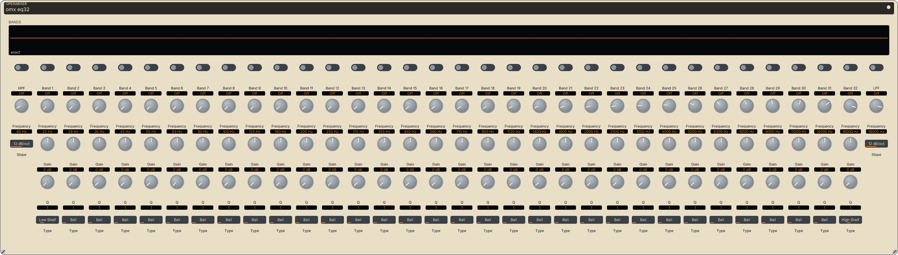

<!-- SPDX-License-Identifier: GPL-3.0-or-later -->
<!-- Copyright (C) 2026 Pau Aliagas <linuxnow@gmail.com> -->
<!-- Generated by tools/params-doc.mjs from the declarations; edit them and run `make params-doc`. -->

# omx eq32

The OpenMixer console's channel EQ, 32-band form: 32 parametric bands (bell, shelves, notch, all-pass) and a high-pass and a low-pass filter at 12 or 24 dB/oct, stereo, zero latency; every band ships off, so a racked instance is a wire.

- CLAP id: `org.openmixer.eq32`
- LV2 URI: `urn:openmixer:eq32`
- Parameters: 166, plus the host's bypass

## Panel

The panel as a host draws it from the declaration alone, every control at its default (`make panel-images`: omx-panel lays it out and its renderer draws it). Its sections and their controls, in order:

| Section | Controls |
|---|---|
| Bands | on, type, freq, gain, q |
| HPF | HPF On, HPF Slope, HPF Frequency |
| LPF | LPF On, LPF Slope, LPF Frequency |

## Audio ports

| Direction | Name | Role | Channels |
|---|---|---|---|
| in | in | main | 2 (stereo) |
| out | out | main | 2 (stereo) |

## Pages

A page is where a host shows a parameter. In LV2 each page is a port group, `pg:group <urn:openmixer:eq32#<symbol>>`, whose `lv2:displayPriority` is the number below (a host that shows the higher first, as Zynthian does, shows the pages in port order). In CLAP each page is the module of its parameters (`clap_param_info.module`), the page labels joined by `/`.

| Page | LV2 group symbol | Priority | CLAP module | Parameters |
|---|---|---|---|---|
| HPF | `hpf` | 34 | `HPF` | 3 |
| LPF | `lpf` | 33 | `LPF` | 3 |
| Bands / Band 1 | `band1` | 32 | `Bands/Band 1` | 5 |
| Bands / Band 2 | `band2` | 31 | `Bands/Band 2` | 5 |
| Bands / Band 3 | `band3` | 30 | `Bands/Band 3` | 5 |
| Bands / Band 4 | `band4` | 29 | `Bands/Band 4` | 5 |
| Bands / Band 5 | `band5` | 28 | `Bands/Band 5` | 5 |
| Bands / Band 6 | `band6` | 27 | `Bands/Band 6` | 5 |
| Bands / Band 7 | `band7` | 26 | `Bands/Band 7` | 5 |
| Bands / Band 8 | `band8` | 25 | `Bands/Band 8` | 5 |
| Bands / Band 9 | `band9` | 24 | `Bands/Band 9` | 5 |
| Bands / Band 10 | `band10` | 23 | `Bands/Band 10` | 5 |
| Bands / Band 11 | `band11` | 22 | `Bands/Band 11` | 5 |
| Bands / Band 12 | `band12` | 21 | `Bands/Band 12` | 5 |
| Bands / Band 13 | `band13` | 20 | `Bands/Band 13` | 5 |
| Bands / Band 14 | `band14` | 19 | `Bands/Band 14` | 5 |
| Bands / Band 15 | `band15` | 18 | `Bands/Band 15` | 5 |
| Bands / Band 16 | `band16` | 17 | `Bands/Band 16` | 5 |
| Bands / Band 17 | `band17` | 16 | `Bands/Band 17` | 5 |
| Bands / Band 18 | `band18` | 15 | `Bands/Band 18` | 5 |
| Bands / Band 19 | `band19` | 14 | `Bands/Band 19` | 5 |
| Bands / Band 20 | `band20` | 13 | `Bands/Band 20` | 5 |
| Bands / Band 21 | `band21` | 12 | `Bands/Band 21` | 5 |
| Bands / Band 22 | `band22` | 11 | `Bands/Band 22` | 5 |
| Bands / Band 23 | `band23` | 10 | `Bands/Band 23` | 5 |
| Bands / Band 24 | `band24` | 9 | `Bands/Band 24` | 5 |
| Bands / Band 25 | `band25` | 8 | `Bands/Band 25` | 5 |
| Bands / Band 26 | `band26` | 7 | `Bands/Band 26` | 5 |
| Bands / Band 27 | `band27` | 6 | `Bands/Band 27` | 5 |
| Bands / Band 28 | `band28` | 5 | `Bands/Band 28` | 5 |
| Bands / Band 29 | `band29` | 4 | `Bands/Band 29` | 5 |
| Bands / Band 30 | `band30` | 3 | `Bands/Band 30` | 5 |
| Bands / Band 31 | `band31` | 2 | `Bands/Band 31` | 5 |
| Bands / Band 32 | `band32` | 1 | `Bands/Band 32` | 5 |

## Parameters

Ids are the order below, 0 to 165; a parameter appended later takes the next id. The bypass's id is its own (below).

| Id | Symbol | Name | Unit | Min | Max | Default | Step or values | Flags | Page (priority) |
|---|---|---|---|---|---|---|---|---|---|
| 0 | `hpf_on` | HPF On |  | off | on | off | toggle | automatable | HPF (34) |
| 1 | `hpf_freq` | HPF Frequency | Hz | 20 | 1000 | 80 | whole steps | automatable | HPF (34) |
| 2 | `hpf_slope` | HPF Slope |  | 12 | 24 | 12 dB/oct (12) | 12 12 dB/oct, 24 24 dB/oct | automatable | HPF (34) |
| 3 | `lpf_on` | LPF On |  | off | on | off | toggle | automatable | LPF (33) |
| 4 | `lpf_freq` | LPF Frequency | Hz | 1000 | 20000 | 18000 | whole steps | automatable | LPF (33) |
| 5 | `lpf_slope` | LPF Slope |  | 12 | 24 | 12 dB/oct (12) | 12 12 dB/oct, 24 24 dB/oct | automatable | LPF (33) |
| 6 | `b1_type` | Band 1 Type |  | 0 | 5 | Low Shelf (1) | 0 Bell, 1 Low Shelf, 2 High Shelf, 3 Notch, 4 All-pass 1st, 5 All-pass 2nd | automatable | Bands / Band 1 (32) |
| 7 | `b1_freq` | Band 1 Frequency | Hz | 20 | 20000 | 22.4 | whole steps | automatable | Bands / Band 1 (32) |
| 8 | `b1_gain` | Band 1 Gain | dB | -15 | 15 | 0 | continuous, linear | automatable | Bands / Band 1 (32) |
| 9 | `b1_q` | Band 1 Q |  | 0.3 | 116 | 1 | continuous, linear | automatable | Bands / Band 1 (32) |
| 10 | `b1_on` | Band 1 On |  | off | on | off | toggle | automatable | Bands / Band 1 (32) |
| 11 | `b2_type` | Band 2 Type |  | 0 | 5 | Bell (0) | 0 Bell, 1 Low Shelf, 2 High Shelf, 3 Notch, 4 All-pass 1st, 5 All-pass 2nd | automatable | Bands / Band 2 (31) |
| 12 | `b2_freq` | Band 2 Frequency | Hz | 20 | 20000 | 28 | whole steps | automatable | Bands / Band 2 (31) |
| 13 | `b2_gain` | Band 2 Gain | dB | -15 | 15 | 0 | continuous, linear | automatable | Bands / Band 2 (31) |
| 14 | `b2_q` | Band 2 Q |  | 0.3 | 116 | 1 | continuous, linear | automatable | Bands / Band 2 (31) |
| 15 | `b2_on` | Band 2 On |  | off | on | off | toggle | automatable | Bands / Band 2 (31) |
| 16 | `b3_type` | Band 3 Type |  | 0 | 5 | Bell (0) | 0 Bell, 1 Low Shelf, 2 High Shelf, 3 Notch, 4 All-pass 1st, 5 All-pass 2nd | automatable | Bands / Band 3 (30) |
| 17 | `b3_freq` | Band 3 Frequency | Hz | 20 | 20000 | 35.5 | whole steps | automatable | Bands / Band 3 (30) |
| 18 | `b3_gain` | Band 3 Gain | dB | -15 | 15 | 0 | continuous, linear | automatable | Bands / Band 3 (30) |
| 19 | `b3_q` | Band 3 Q |  | 0.3 | 116 | 1 | continuous, linear | automatable | Bands / Band 3 (30) |
| 20 | `b3_on` | Band 3 On |  | off | on | off | toggle | automatable | Bands / Band 3 (30) |
| 21 | `b4_type` | Band 4 Type |  | 0 | 5 | Bell (0) | 0 Bell, 1 Low Shelf, 2 High Shelf, 3 Notch, 4 All-pass 1st, 5 All-pass 2nd | automatable | Bands / Band 4 (29) |
| 22 | `b4_freq` | Band 4 Frequency | Hz | 20 | 20000 | 45 | whole steps | automatable | Bands / Band 4 (29) |
| 23 | `b4_gain` | Band 4 Gain | dB | -15 | 15 | 0 | continuous, linear | automatable | Bands / Band 4 (29) |
| 24 | `b4_q` | Band 4 Q |  | 0.3 | 116 | 1 | continuous, linear | automatable | Bands / Band 4 (29) |
| 25 | `b4_on` | Band 4 On |  | off | on | off | toggle | automatable | Bands / Band 4 (29) |
| 26 | `b5_type` | Band 5 Type |  | 0 | 5 | Bell (0) | 0 Bell, 1 Low Shelf, 2 High Shelf, 3 Notch, 4 All-pass 1st, 5 All-pass 2nd | automatable | Bands / Band 5 (28) |
| 27 | `b5_freq` | Band 5 Frequency | Hz | 20 | 20000 | 50 | whole steps | automatable | Bands / Band 5 (28) |
| 28 | `b5_gain` | Band 5 Gain | dB | -15 | 15 | 0 | continuous, linear | automatable | Bands / Band 5 (28) |
| 29 | `b5_q` | Band 5 Q |  | 0.3 | 116 | 1 | continuous, linear | automatable | Bands / Band 5 (28) |
| 30 | `b5_on` | Band 5 On |  | off | on | off | toggle | automatable | Bands / Band 5 (28) |
| 31 | `b6_type` | Band 6 Type |  | 0 | 5 | Bell (0) | 0 Bell, 1 Low Shelf, 2 High Shelf, 3 Notch, 4 All-pass 1st, 5 All-pass 2nd | automatable | Bands / Band 6 (27) |
| 32 | `b6_freq` | Band 6 Frequency | Hz | 20 | 20000 | 63 | whole steps | automatable | Bands / Band 6 (27) |
| 33 | `b6_gain` | Band 6 Gain | dB | -15 | 15 | 0 | continuous, linear | automatable | Bands / Band 6 (27) |
| 34 | `b6_q` | Band 6 Q |  | 0.3 | 116 | 1 | continuous, linear | automatable | Bands / Band 6 (27) |
| 35 | `b6_on` | Band 6 On |  | off | on | off | toggle | automatable | Bands / Band 6 (27) |
| 36 | `b7_type` | Band 7 Type |  | 0 | 5 | Bell (0) | 0 Bell, 1 Low Shelf, 2 High Shelf, 3 Notch, 4 All-pass 1st, 5 All-pass 2nd | automatable | Bands / Band 7 (26) |
| 37 | `b7_freq` | Band 7 Frequency | Hz | 20 | 20000 | 80 | whole steps | automatable | Bands / Band 7 (26) |
| 38 | `b7_gain` | Band 7 Gain | dB | -15 | 15 | 0 | continuous, linear | automatable | Bands / Band 7 (26) |
| 39 | `b7_q` | Band 7 Q |  | 0.3 | 116 | 1 | continuous, linear | automatable | Bands / Band 7 (26) |
| 40 | `b7_on` | Band 7 On |  | off | on | off | toggle | automatable | Bands / Band 7 (26) |
| 41 | `b8_type` | Band 8 Type |  | 0 | 5 | Bell (0) | 0 Bell, 1 Low Shelf, 2 High Shelf, 3 Notch, 4 All-pass 1st, 5 All-pass 2nd | automatable | Bands / Band 8 (25) |
| 42 | `b8_freq` | Band 8 Frequency | Hz | 20 | 20000 | 100 | whole steps | automatable | Bands / Band 8 (25) |
| 43 | `b8_gain` | Band 8 Gain | dB | -15 | 15 | 0 | continuous, linear | automatable | Bands / Band 8 (25) |
| 44 | `b8_q` | Band 8 Q |  | 0.3 | 116 | 1 | continuous, linear | automatable | Bands / Band 8 (25) |
| 45 | `b8_on` | Band 8 On |  | off | on | off | toggle | automatable | Bands / Band 8 (25) |
| 46 | `b9_type` | Band 9 Type |  | 0 | 5 | Bell (0) | 0 Bell, 1 Low Shelf, 2 High Shelf, 3 Notch, 4 All-pass 1st, 5 All-pass 2nd | automatable | Bands / Band 9 (24) |
| 47 | `b9_freq` | Band 9 Frequency | Hz | 20 | 20000 | 125 | whole steps | automatable | Bands / Band 9 (24) |
| 48 | `b9_gain` | Band 9 Gain | dB | -15 | 15 | 0 | continuous, linear | automatable | Bands / Band 9 (24) |
| 49 | `b9_q` | Band 9 Q |  | 0.3 | 116 | 1 | continuous, linear | automatable | Bands / Band 9 (24) |
| 50 | `b9_on` | Band 9 On |  | off | on | off | toggle | automatable | Bands / Band 9 (24) |
| 51 | `b10_type` | Band 10 Type |  | 0 | 5 | Bell (0) | 0 Bell, 1 Low Shelf, 2 High Shelf, 3 Notch, 4 All-pass 1st, 5 All-pass 2nd | automatable | Bands / Band 10 (23) |
| 52 | `b10_freq` | Band 10 Frequency | Hz | 20 | 20000 | 160 | whole steps | automatable | Bands / Band 10 (23) |
| 53 | `b10_gain` | Band 10 Gain | dB | -15 | 15 | 0 | continuous, linear | automatable | Bands / Band 10 (23) |
| 54 | `b10_q` | Band 10 Q |  | 0.3 | 116 | 1 | continuous, linear | automatable | Bands / Band 10 (23) |
| 55 | `b10_on` | Band 10 On |  | off | on | off | toggle | automatable | Bands / Band 10 (23) |
| 56 | `b11_type` | Band 11 Type |  | 0 | 5 | Bell (0) | 0 Bell, 1 Low Shelf, 2 High Shelf, 3 Notch, 4 All-pass 1st, 5 All-pass 2nd | automatable | Bands / Band 11 (22) |
| 57 | `b11_freq` | Band 11 Frequency | Hz | 20 | 20000 | 200 | whole steps | automatable | Bands / Band 11 (22) |
| 58 | `b11_gain` | Band 11 Gain | dB | -15 | 15 | 0 | continuous, linear | automatable | Bands / Band 11 (22) |
| 59 | `b11_q` | Band 11 Q |  | 0.3 | 116 | 1 | continuous, linear | automatable | Bands / Band 11 (22) |
| 60 | `b11_on` | Band 11 On |  | off | on | off | toggle | automatable | Bands / Band 11 (22) |
| 61 | `b12_type` | Band 12 Type |  | 0 | 5 | Bell (0) | 0 Bell, 1 Low Shelf, 2 High Shelf, 3 Notch, 4 All-pass 1st, 5 All-pass 2nd | automatable | Bands / Band 12 (21) |
| 62 | `b12_freq` | Band 12 Frequency | Hz | 20 | 20000 | 250 | whole steps | automatable | Bands / Band 12 (21) |
| 63 | `b12_gain` | Band 12 Gain | dB | -15 | 15 | 0 | continuous, linear | automatable | Bands / Band 12 (21) |
| 64 | `b12_q` | Band 12 Q |  | 0.3 | 116 | 1 | continuous, linear | automatable | Bands / Band 12 (21) |
| 65 | `b12_on` | Band 12 On |  | off | on | off | toggle | automatable | Bands / Band 12 (21) |
| 66 | `b13_type` | Band 13 Type |  | 0 | 5 | Bell (0) | 0 Bell, 1 Low Shelf, 2 High Shelf, 3 Notch, 4 All-pass 1st, 5 All-pass 2nd | automatable | Bands / Band 13 (20) |
| 67 | `b13_freq` | Band 13 Frequency | Hz | 20 | 20000 | 315 | whole steps | automatable | Bands / Band 13 (20) |
| 68 | `b13_gain` | Band 13 Gain | dB | -15 | 15 | 0 | continuous, linear | automatable | Bands / Band 13 (20) |
| 69 | `b13_q` | Band 13 Q |  | 0.3 | 116 | 1 | continuous, linear | automatable | Bands / Band 13 (20) |
| 70 | `b13_on` | Band 13 On |  | off | on | off | toggle | automatable | Bands / Band 13 (20) |
| 71 | `b14_type` | Band 14 Type |  | 0 | 5 | Bell (0) | 0 Bell, 1 Low Shelf, 2 High Shelf, 3 Notch, 4 All-pass 1st, 5 All-pass 2nd | automatable | Bands / Band 14 (19) |
| 72 | `b14_freq` | Band 14 Frequency | Hz | 20 | 20000 | 355 | whole steps | automatable | Bands / Band 14 (19) |
| 73 | `b14_gain` | Band 14 Gain | dB | -15 | 15 | 0 | continuous, linear | automatable | Bands / Band 14 (19) |
| 74 | `b14_q` | Band 14 Q |  | 0.3 | 116 | 1 | continuous, linear | automatable | Bands / Band 14 (19) |
| 75 | `b14_on` | Band 14 On |  | off | on | off | toggle | automatable | Bands / Band 14 (19) |
| 76 | `b15_type` | Band 15 Type |  | 0 | 5 | Bell (0) | 0 Bell, 1 Low Shelf, 2 High Shelf, 3 Notch, 4 All-pass 1st, 5 All-pass 2nd | automatable | Bands / Band 15 (18) |
| 77 | `b15_freq` | Band 15 Frequency | Hz | 20 | 20000 | 450 | whole steps | automatable | Bands / Band 15 (18) |
| 78 | `b15_gain` | Band 15 Gain | dB | -15 | 15 | 0 | continuous, linear | automatable | Bands / Band 15 (18) |
| 79 | `b15_q` | Band 15 Q |  | 0.3 | 116 | 1 | continuous, linear | automatable | Bands / Band 15 (18) |
| 80 | `b15_on` | Band 15 On |  | off | on | off | toggle | automatable | Bands / Band 15 (18) |
| 81 | `b16_type` | Band 16 Type |  | 0 | 5 | Bell (0) | 0 Bell, 1 Low Shelf, 2 High Shelf, 3 Notch, 4 All-pass 1st, 5 All-pass 2nd | automatable | Bands / Band 16 (17) |
| 82 | `b16_freq` | Band 16 Frequency | Hz | 20 | 20000 | 560 | whole steps | automatable | Bands / Band 16 (17) |
| 83 | `b16_gain` | Band 16 Gain | dB | -15 | 15 | 0 | continuous, linear | automatable | Bands / Band 16 (17) |
| 84 | `b16_q` | Band 16 Q |  | 0.3 | 116 | 1 | continuous, linear | automatable | Bands / Band 16 (17) |
| 85 | `b16_on` | Band 16 On |  | off | on | off | toggle | automatable | Bands / Band 16 (17) |
| 86 | `b17_type` | Band 17 Type |  | 0 | 5 | Bell (0) | 0 Bell, 1 Low Shelf, 2 High Shelf, 3 Notch, 4 All-pass 1st, 5 All-pass 2nd | automatable | Bands / Band 17 (16) |
| 87 | `b17_freq` | Band 17 Frequency | Hz | 20 | 20000 | 710 | whole steps | automatable | Bands / Band 17 (16) |
| 88 | `b17_gain` | Band 17 Gain | dB | -15 | 15 | 0 | continuous, linear | automatable | Bands / Band 17 (16) |
| 89 | `b17_q` | Band 17 Q |  | 0.3 | 116 | 1 | continuous, linear | automatable | Bands / Band 17 (16) |
| 90 | `b17_on` | Band 17 On |  | off | on | off | toggle | automatable | Bands / Band 17 (16) |
| 91 | `b18_type` | Band 18 Type |  | 0 | 5 | Bell (0) | 0 Bell, 1 Low Shelf, 2 High Shelf, 3 Notch, 4 All-pass 1st, 5 All-pass 2nd | automatable | Bands / Band 18 (15) |
| 92 | `b18_freq` | Band 18 Frequency | Hz | 20 | 20000 | 900 | whole steps | automatable | Bands / Band 18 (15) |
| 93 | `b18_gain` | Band 18 Gain | dB | -15 | 15 | 0 | continuous, linear | automatable | Bands / Band 18 (15) |
| 94 | `b18_q` | Band 18 Q |  | 0.3 | 116 | 1 | continuous, linear | automatable | Bands / Band 18 (15) |
| 95 | `b18_on` | Band 18 On |  | off | on | off | toggle | automatable | Bands / Band 18 (15) |
| 96 | `b19_type` | Band 19 Type |  | 0 | 5 | Bell (0) | 0 Bell, 1 Low Shelf, 2 High Shelf, 3 Notch, 4 All-pass 1st, 5 All-pass 2nd | automatable | Bands / Band 19 (14) |
| 97 | `b19_freq` | Band 19 Frequency | Hz | 20 | 20000 | 1120 | whole steps | automatable | Bands / Band 19 (14) |
| 98 | `b19_gain` | Band 19 Gain | dB | -15 | 15 | 0 | continuous, linear | automatable | Bands / Band 19 (14) |
| 99 | `b19_q` | Band 19 Q |  | 0.3 | 116 | 1 | continuous, linear | automatable | Bands / Band 19 (14) |
| 100 | `b19_on` | Band 19 On |  | off | on | off | toggle | automatable | Bands / Band 19 (14) |
| 101 | `b20_type` | Band 20 Type |  | 0 | 5 | Bell (0) | 0 Bell, 1 Low Shelf, 2 High Shelf, 3 Notch, 4 All-pass 1st, 5 All-pass 2nd | automatable | Bands / Band 20 (13) |
| 102 | `b20_freq` | Band 20 Frequency | Hz | 20 | 20000 | 1400 | whole steps | automatable | Bands / Band 20 (13) |
| 103 | `b20_gain` | Band 20 Gain | dB | -15 | 15 | 0 | continuous, linear | automatable | Bands / Band 20 (13) |
| 104 | `b20_q` | Band 20 Q |  | 0.3 | 116 | 1 | continuous, linear | automatable | Bands / Band 20 (13) |
| 105 | `b20_on` | Band 20 On |  | off | on | off | toggle | automatable | Bands / Band 20 (13) |
| 106 | `b21_type` | Band 21 Type |  | 0 | 5 | Bell (0) | 0 Bell, 1 Low Shelf, 2 High Shelf, 3 Notch, 4 All-pass 1st, 5 All-pass 2nd | automatable | Bands / Band 21 (12) |
| 107 | `b21_freq` | Band 21 Frequency | Hz | 20 | 20000 | 1600 | whole steps | automatable | Bands / Band 21 (12) |
| 108 | `b21_gain` | Band 21 Gain | dB | -15 | 15 | 0 | continuous, linear | automatable | Bands / Band 21 (12) |
| 109 | `b21_q` | Band 21 Q |  | 0.3 | 116 | 1 | continuous, linear | automatable | Bands / Band 21 (12) |
| 110 | `b21_on` | Band 21 On |  | off | on | off | toggle | automatable | Bands / Band 21 (12) |
| 111 | `b22_type` | Band 22 Type |  | 0 | 5 | Bell (0) | 0 Bell, 1 Low Shelf, 2 High Shelf, 3 Notch, 4 All-pass 1st, 5 All-pass 2nd | automatable | Bands / Band 22 (11) |
| 112 | `b22_freq` | Band 22 Frequency | Hz | 20 | 20000 | 2000 | whole steps | automatable | Bands / Band 22 (11) |
| 113 | `b22_gain` | Band 22 Gain | dB | -15 | 15 | 0 | continuous, linear | automatable | Bands / Band 22 (11) |
| 114 | `b22_q` | Band 22 Q |  | 0.3 | 116 | 1 | continuous, linear | automatable | Bands / Band 22 (11) |
| 115 | `b22_on` | Band 22 On |  | off | on | off | toggle | automatable | Bands / Band 22 (11) |
| 116 | `b23_type` | Band 23 Type |  | 0 | 5 | Bell (0) | 0 Bell, 1 Low Shelf, 2 High Shelf, 3 Notch, 4 All-pass 1st, 5 All-pass 2nd | automatable | Bands / Band 23 (10) |
| 117 | `b23_freq` | Band 23 Frequency | Hz | 20 | 20000 | 2500 | whole steps | automatable | Bands / Band 23 (10) |
| 118 | `b23_gain` | Band 23 Gain | dB | -15 | 15 | 0 | continuous, linear | automatable | Bands / Band 23 (10) |
| 119 | `b23_q` | Band 23 Q |  | 0.3 | 116 | 1 | continuous, linear | automatable | Bands / Band 23 (10) |
| 120 | `b23_on` | Band 23 On |  | off | on | off | toggle | automatable | Bands / Band 23 (10) |
| 121 | `b24_type` | Band 24 Type |  | 0 | 5 | Bell (0) | 0 Bell, 1 Low Shelf, 2 High Shelf, 3 Notch, 4 All-pass 1st, 5 All-pass 2nd | automatable | Bands / Band 24 (9) |
| 122 | `b24_freq` | Band 24 Frequency | Hz | 20 | 20000 | 3150 | whole steps | automatable | Bands / Band 24 (9) |
| 123 | `b24_gain` | Band 24 Gain | dB | -15 | 15 | 0 | continuous, linear | automatable | Bands / Band 24 (9) |
| 124 | `b24_q` | Band 24 Q |  | 0.3 | 116 | 1 | continuous, linear | automatable | Bands / Band 24 (9) |
| 125 | `b24_on` | Band 24 On |  | off | on | off | toggle | automatable | Bands / Band 24 (9) |
| 126 | `b25_type` | Band 25 Type |  | 0 | 5 | Bell (0) | 0 Bell, 1 Low Shelf, 2 High Shelf, 3 Notch, 4 All-pass 1st, 5 All-pass 2nd | automatable | Bands / Band 25 (8) |
| 127 | `b25_freq` | Band 25 Frequency | Hz | 20 | 20000 | 4000 | whole steps | automatable | Bands / Band 25 (8) |
| 128 | `b25_gain` | Band 25 Gain | dB | -15 | 15 | 0 | continuous, linear | automatable | Bands / Band 25 (8) |
| 129 | `b25_q` | Band 25 Q |  | 0.3 | 116 | 1 | continuous, linear | automatable | Bands / Band 25 (8) |
| 130 | `b25_on` | Band 25 On |  | off | on | off | toggle | automatable | Bands / Band 25 (8) |
| 131 | `b26_type` | Band 26 Type |  | 0 | 5 | Bell (0) | 0 Bell, 1 Low Shelf, 2 High Shelf, 3 Notch, 4 All-pass 1st, 5 All-pass 2nd | automatable | Bands / Band 26 (7) |
| 132 | `b26_freq` | Band 26 Frequency | Hz | 20 | 20000 | 5000 | whole steps | automatable | Bands / Band 26 (7) |
| 133 | `b26_gain` | Band 26 Gain | dB | -15 | 15 | 0 | continuous, linear | automatable | Bands / Band 26 (7) |
| 134 | `b26_q` | Band 26 Q |  | 0.3 | 116 | 1 | continuous, linear | automatable | Bands / Band 26 (7) |
| 135 | `b26_on` | Band 26 On |  | off | on | off | toggle | automatable | Bands / Band 26 (7) |
| 136 | `b27_type` | Band 27 Type |  | 0 | 5 | Bell (0) | 0 Bell, 1 Low Shelf, 2 High Shelf, 3 Notch, 4 All-pass 1st, 5 All-pass 2nd | automatable | Bands / Band 27 (6) |
| 137 | `b27_freq` | Band 27 Frequency | Hz | 20 | 20000 | 6300 | whole steps | automatable | Bands / Band 27 (6) |
| 138 | `b27_gain` | Band 27 Gain | dB | -15 | 15 | 0 | continuous, linear | automatable | Bands / Band 27 (6) |
| 139 | `b27_q` | Band 27 Q |  | 0.3 | 116 | 1 | continuous, linear | automatable | Bands / Band 27 (6) |
| 140 | `b27_on` | Band 27 On |  | off | on | off | toggle | automatable | Bands / Band 27 (6) |
| 141 | `b28_type` | Band 28 Type |  | 0 | 5 | Bell (0) | 0 Bell, 1 Low Shelf, 2 High Shelf, 3 Notch, 4 All-pass 1st, 5 All-pass 2nd | automatable | Bands / Band 28 (5) |
| 142 | `b28_freq` | Band 28 Frequency | Hz | 20 | 20000 | 8000 | whole steps | automatable | Bands / Band 28 (5) |
| 143 | `b28_gain` | Band 28 Gain | dB | -15 | 15 | 0 | continuous, linear | automatable | Bands / Band 28 (5) |
| 144 | `b28_q` | Band 28 Q |  | 0.3 | 116 | 1 | continuous, linear | automatable | Bands / Band 28 (5) |
| 145 | `b28_on` | Band 28 On |  | off | on | off | toggle | automatable | Bands / Band 28 (5) |
| 146 | `b29_type` | Band 29 Type |  | 0 | 5 | Bell (0) | 0 Bell, 1 Low Shelf, 2 High Shelf, 3 Notch, 4 All-pass 1st, 5 All-pass 2nd | automatable | Bands / Band 29 (4) |
| 147 | `b29_freq` | Band 29 Frequency | Hz | 20 | 20000 | 9000 | whole steps | automatable | Bands / Band 29 (4) |
| 148 | `b29_gain` | Band 29 Gain | dB | -15 | 15 | 0 | continuous, linear | automatable | Bands / Band 29 (4) |
| 149 | `b29_q` | Band 29 Q |  | 0.3 | 116 | 1 | continuous, linear | automatable | Bands / Band 29 (4) |
| 150 | `b29_on` | Band 29 On |  | off | on | off | toggle | automatable | Bands / Band 29 (4) |
| 151 | `b30_type` | Band 30 Type |  | 0 | 5 | Bell (0) | 0 Bell, 1 Low Shelf, 2 High Shelf, 3 Notch, 4 All-pass 1st, 5 All-pass 2nd | automatable | Bands / Band 30 (3) |
| 152 | `b30_freq` | Band 30 Frequency | Hz | 20 | 20000 | 11200 | whole steps | automatable | Bands / Band 30 (3) |
| 153 | `b30_gain` | Band 30 Gain | dB | -15 | 15 | 0 | continuous, linear | automatable | Bands / Band 30 (3) |
| 154 | `b30_q` | Band 30 Q |  | 0.3 | 116 | 1 | continuous, linear | automatable | Bands / Band 30 (3) |
| 155 | `b30_on` | Band 30 On |  | off | on | off | toggle | automatable | Bands / Band 30 (3) |
| 156 | `b31_type` | Band 31 Type |  | 0 | 5 | Bell (0) | 0 Bell, 1 Low Shelf, 2 High Shelf, 3 Notch, 4 All-pass 1st, 5 All-pass 2nd | automatable | Bands / Band 31 (2) |
| 157 | `b31_freq` | Band 31 Frequency | Hz | 20 | 20000 | 14000 | whole steps | automatable | Bands / Band 31 (2) |
| 158 | `b31_gain` | Band 31 Gain | dB | -15 | 15 | 0 | continuous, linear | automatable | Bands / Band 31 (2) |
| 159 | `b31_q` | Band 31 Q |  | 0.3 | 116 | 1 | continuous, linear | automatable | Bands / Band 31 (2) |
| 160 | `b31_on` | Band 31 On |  | off | on | off | toggle | automatable | Bands / Band 31 (2) |
| 161 | `b32_type` | Band 32 Type |  | 0 | 5 | High Shelf (2) | 0 Bell, 1 Low Shelf, 2 High Shelf, 3 Notch, 4 All-pass 1st, 5 All-pass 2nd | automatable | Bands / Band 32 (1) |
| 162 | `b32_freq` | Band 32 Frequency | Hz | 20 | 20000 | 18000 | whole steps | automatable | Bands / Band 32 (1) |
| 163 | `b32_gain` | Band 32 Gain | dB | -15 | 15 | 0 | continuous, linear | automatable | Bands / Band 32 (1) |
| 164 | `b32_q` | Band 32 Q |  | 0.3 | 116 | 1 | continuous, linear | automatable | Bands / Band 32 (1) |
| 165 | `b32_on` | Band 32 On |  | off | on | off | toggle | automatable | Bands / Band 32 (1) |

## Bypass

CLAP: the host's bypass, a parameter named Bypass at id 2147418112 (0x7FFF0000) in every plugin, flagged automatable, stepped and bypass; 0 is processing, 1 bypassed. The id never moves when a parameter is appended.
LV2: the port `enabled` (`lv2:designation lv2:enabled`) at index 0, 1 is processing, 0 is bypassed; the output port `latency` at index 1 reports the latency in frames. Both come before the audio and parameter ports in every plugin, so neither moves; a preset or a session names a port by its symbol.
