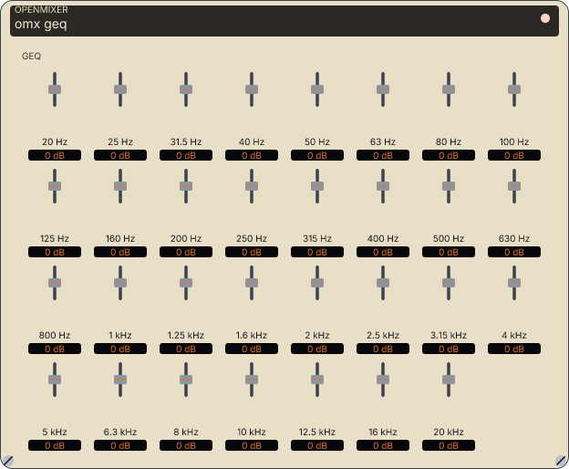

<!-- SPDX-License-Identifier: GPL-3.0-or-later -->
<!-- Copyright (C) 2026 Pau Aliagas <linuxnow@gmail.com> -->
<!-- Generated by tools/params-doc.mjs from the declarations; edit them and run `make params-doc`. -->

# omx geq

The console's 31-band graphic EQ: one fader per ISO third-octave band from 20 Hz to 20 kHz, each cutting or boosting by up to 15 dB.

- CLAP id: `org.openmixer.geq`
- LV2 URI: `urn:openmixer:geq`
- Parameters: 31, plus the host's bypass

## Panel

The panel as a host draws it from the declaration alone, every control at its default (`make panel-images`: omx-panel lays it out and its renderer draws it). Its sections and their controls, in order:

| Section | Controls |
|---|---|
| Geq | 20 Hz, 25 Hz, 31.5 Hz, 40 Hz, 50 Hz, 63 Hz, 80 Hz, 100 Hz, 125 Hz, 160 Hz, 200 Hz, 250 Hz, 315 Hz, 400 Hz, 500 Hz, 630 Hz, 800 Hz, 1 kHz, 1.25 kHz, 1.6 kHz, 2 kHz, 2.5 kHz, 3.15 kHz, 4 kHz, 5 kHz, 6.3 kHz, 8 kHz, 10 kHz, 12.5 kHz, 16 kHz, 20 kHz |

## Audio ports

| Direction | Name | Role | Channels |
|---|---|---|---|
| in | in | main | 2 (stereo) |
| out | out | main | 2 (stereo) |

## Pages

A page is where a host shows a parameter. In LV2 each page is a port group, `pg:group <urn:openmixer:geq#<symbol>>`, whose `lv2:displayPriority` is the number below (a host that shows the higher first, as Zynthian does, shows the pages in port order). In CLAP each page is the module of its parameters (`clap_param_info.module`), the page labels joined by `/`.

| Page | LV2 group symbol | Priority | CLAP module | Parameters |
|---|---|---|---|---|
| Geq | `geq` | 1 | `Geq` | 31 |

## Parameters

Ids are the order below, 0 to 30; a parameter appended later takes the next id. The bypass's id is its own (below).

| Id | Symbol | Name | Unit | Min | Max | Default | Step or values | Flags | Page (priority) |
|---|---|---|---|---|---|---|---|---|---|
| 0 | `band01` | 20 Hz | dB | -15 | 15 | 0 | continuous, linear | automatable | Geq (1) |
| 1 | `band02` | 25 Hz | dB | -15 | 15 | 0 | continuous, linear | automatable | Geq (1) |
| 2 | `band03` | 31.5 Hz | dB | -15 | 15 | 0 | continuous, linear | automatable | Geq (1) |
| 3 | `band04` | 40 Hz | dB | -15 | 15 | 0 | continuous, linear | automatable | Geq (1) |
| 4 | `band05` | 50 Hz | dB | -15 | 15 | 0 | continuous, linear | automatable | Geq (1) |
| 5 | `band06` | 63 Hz | dB | -15 | 15 | 0 | continuous, linear | automatable | Geq (1) |
| 6 | `band07` | 80 Hz | dB | -15 | 15 | 0 | continuous, linear | automatable | Geq (1) |
| 7 | `band08` | 100 Hz | dB | -15 | 15 | 0 | continuous, linear | automatable | Geq (1) |
| 8 | `band09` | 125 Hz | dB | -15 | 15 | 0 | continuous, linear | automatable | Geq (1) |
| 9 | `band10` | 160 Hz | dB | -15 | 15 | 0 | continuous, linear | automatable | Geq (1) |
| 10 | `band11` | 200 Hz | dB | -15 | 15 | 0 | continuous, linear | automatable | Geq (1) |
| 11 | `band12` | 250 Hz | dB | -15 | 15 | 0 | continuous, linear | automatable | Geq (1) |
| 12 | `band13` | 315 Hz | dB | -15 | 15 | 0 | continuous, linear | automatable | Geq (1) |
| 13 | `band14` | 400 Hz | dB | -15 | 15 | 0 | continuous, linear | automatable | Geq (1) |
| 14 | `band15` | 500 Hz | dB | -15 | 15 | 0 | continuous, linear | automatable | Geq (1) |
| 15 | `band16` | 630 Hz | dB | -15 | 15 | 0 | continuous, linear | automatable | Geq (1) |
| 16 | `band17` | 800 Hz | dB | -15 | 15 | 0 | continuous, linear | automatable | Geq (1) |
| 17 | `band18` | 1 kHz | dB | -15 | 15 | 0 | continuous, linear | automatable | Geq (1) |
| 18 | `band19` | 1.25 kHz | dB | -15 | 15 | 0 | continuous, linear | automatable | Geq (1) |
| 19 | `band20` | 1.6 kHz | dB | -15 | 15 | 0 | continuous, linear | automatable | Geq (1) |
| 20 | `band21` | 2 kHz | dB | -15 | 15 | 0 | continuous, linear | automatable | Geq (1) |
| 21 | `band22` | 2.5 kHz | dB | -15 | 15 | 0 | continuous, linear | automatable | Geq (1) |
| 22 | `band23` | 3.15 kHz | dB | -15 | 15 | 0 | continuous, linear | automatable | Geq (1) |
| 23 | `band24` | 4 kHz | dB | -15 | 15 | 0 | continuous, linear | automatable | Geq (1) |
| 24 | `band25` | 5 kHz | dB | -15 | 15 | 0 | continuous, linear | automatable | Geq (1) |
| 25 | `band26` | 6.3 kHz | dB | -15 | 15 | 0 | continuous, linear | automatable | Geq (1) |
| 26 | `band27` | 8 kHz | dB | -15 | 15 | 0 | continuous, linear | automatable | Geq (1) |
| 27 | `band28` | 10 kHz | dB | -15 | 15 | 0 | continuous, linear | automatable | Geq (1) |
| 28 | `band29` | 12.5 kHz | dB | -15 | 15 | 0 | continuous, linear | automatable | Geq (1) |
| 29 | `band30` | 16 kHz | dB | -15 | 15 | 0 | continuous, linear | automatable | Geq (1) |
| 30 | `band31` | 20 kHz | dB | -15 | 15 | 0 | continuous, linear | automatable | Geq (1) |

## Bypass

CLAP: the host's bypass, a parameter named Bypass at id 2147418112 (0x7FFF0000) in every plugin, flagged automatable, stepped and bypass; 0 is processing, 1 bypassed. The id never moves when a parameter is appended.
LV2: the port `enabled` (`lv2:designation lv2:enabled`) at index 0, 1 is processing, 0 is bypassed; the output port `latency` at index 1 reports the latency in frames. Both come before the audio and parameter ports in every plugin, so neither moves; a preset or a session names a port by its symbol.
