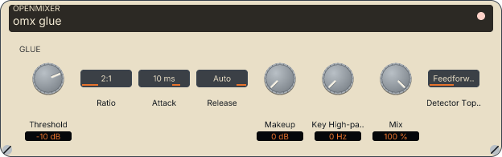

<!-- SPDX-License-Identifier: GPL-3.0-or-later -->
<!-- Copyright (C) 2026 Pau Aliagas <linuxnow@gmail.com> -->
<!-- Generated by tools/params-doc.mjs from the declarations; edit them and run `make params-doc`. -->

# omx glue

A bus compressor with the detents of a classic console: stepped ratio, attack and release, a key filter and a dry mix.

- CLAP id: `org.openmixer.glue`
- LV2 URI: `urn:openmixer:glue`
- Parameters: 8, plus the host's bypass

## Panel

The panel as a host draws it from the declaration alone, every control at its default (`make panel-images`: omx-panel lays it out and its renderer draws it). Its sections and their controls, in order:

| Section | Controls |
|---|---|
| Glue | Threshold, Ratio, Attack, Release, Makeup, Key High-pass, Mix, Detector Topology |

## Audio ports

| Direction | Name | Role | Channels |
|---|---|---|---|
| in | in | main | 2 (stereo) |
| out | out | main | 2 (stereo) |

## Pages

A page is where a host shows a parameter. In LV2 each page is a port group, `pg:group <urn:openmixer:glue#<symbol>>`, whose `lv2:displayPriority` is the number below (a host that shows the higher first, as Zynthian does, shows the pages in port order). In CLAP each page is the module of its parameters (`clap_param_info.module`), the page labels joined by `/`.

| Page | LV2 group symbol | Priority | CLAP module | Parameters |
|---|---|---|---|---|
| Glue | `glue` | 1 | `Glue` | 8 |

## Parameters

Ids are the order below, 0 to 7; a parameter appended later takes the next id. The bypass's id is its own (below).

| Id | Symbol | Name | Unit | Min | Max | Default | Step or values | Flags | Page (priority) |
|---|---|---|---|---|---|---|---|---|---|
| 0 | `thresholdDb` | Threshold | dB | -40 | 0 | -10 | continuous, linear | automatable | Glue (1) |
| 1 | `ratio` | Ratio |  | 0 | 2 | 2:1 (0) | 0 2:1, 1 4:1, 2 10:1 | automatable | Glue (1) |
| 2 | `attack` | Attack |  | 0 | 5 | 10 ms (4) | 0 0.1 ms, 1 0.3 ms, 2 1 ms, 3 3 ms, 4 10 ms, 5 30 ms | automatable | Glue (1) |
| 3 | `release` | Release |  | 0 | 4 | Auto (4) | 0 0.1 s, 1 0.3 s, 2 0.6 s, 3 1.2 s, 4 Auto | automatable | Glue (1) |
| 4 | `makeupDb` | Makeup | dB | 0 | 24 | 0 | continuous, linear | automatable | Glue (1) |
| 5 | `keyHpHz` | Key High-pass | Hz | 0 | 500 | 0 | whole steps | automatable | Glue (1) |
| 6 | `mixPct` | Mix | % | 0 | 100 | 100 | whole steps | automatable | Glue (1) |
| 7 | `detectorTopology` | Detector Topology |  | 0 | 1 | Feedforward (0) | 0 Feedforward, 1 Feedback | automatable | Glue (1) |

## Bypass

CLAP: the host's bypass, a parameter named Bypass at id 2147418112 (0x7FFF0000) in every plugin, flagged automatable, stepped and bypass; 0 is processing, 1 bypassed. The id never moves when a parameter is appended.
LV2: the port `enabled` (`lv2:designation lv2:enabled`) at index 0, 1 is processing, 0 is bypassed; the output port `latency` at index 1 reports the latency in frames. Both come before the audio and parameter ports in every plugin, so neither moves; a preset or a session names a port by its symbol.
