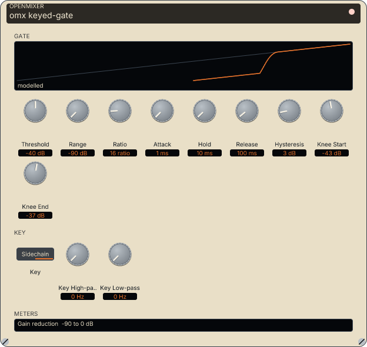

<!-- SPDX-License-Identifier: GPL-3.0-or-later -->
<!-- Copyright (C) 2026 Pau Aliagas <linuxnow@gmail.com> -->
<!-- Generated by tools/params-doc.mjs from the declarations; edit them and run `make params-doc`. -->

# omx keyed-gate

The OpenMixer console's channel gate with an external key: the stereo signal is gated while the detector listens to the sidechain input the host routes to it, or to the signal itself with the key unconnected or set to Self. One gain drives both legs. An attack under 0.5 ms engages 4x detector oversampling, which adds 72 frames of latency, reported to the host. The DSP is omx-dsp's <omxdsp/fx/omx_gate_instance.h>, the console's own gate.

- CLAP id: `org.openmixer.keyed-gate`
- LV2 URI: `urn:openmixer:keyed-gate`
- Parameters: 12, plus the host's bypass

## Panel

The panel as a host draws it from the declaration alone, every control at its default (`make panel-images`: omx-panel lays it out and its renderer draws it). Its sections and their controls, in order:

| Section | Controls |
|---|---|
| Gate | Threshold, Range, Ratio, Attack, Hold, Release, Hysteresis, Knee Start, Knee End |
| Key | Key, Key High-pass, Key Low-pass |

## Audio ports

| Direction | Name | Role | Channels |
|---|---|---|---|
| in | in | main | 2 (stereo) |
| in | key | sidechain | 1 (mono) |
| out | out | main | 2 (stereo) |

## Pages

A page is where a host shows a parameter. In LV2 each page is a port group, `pg:group <urn:openmixer:keyed-gate#<symbol>>`, whose `lv2:displayPriority` is the number below (a host that shows the higher first, as Zynthian does, shows the pages in port order). In CLAP each page is the module of its parameters (`clap_param_info.module`), the page labels joined by `/`.

| Page | LV2 group symbol | Priority | CLAP module | Parameters |
|---|---|---|---|---|
| Key | `key` | 2 | `Key` | 3 |
| Gate | `gate` | 1 | `Gate` | 9 |

## Parameters

Ids are the order below, 0 to 11; a parameter appended later takes the next id. The bypass's id is its own (below).

| Id | Symbol | Name | Unit | Min | Max | Default | Step or values | Flags | Page (priority) |
|---|---|---|---|---|---|---|---|---|---|
| 0 | `key_external` | Key |  | 0 | 1 | Sidechain (1) | 0 Self, 1 Sidechain | automatable | Key (2) |
| 1 | `threshold` | Threshold | dB | -80 | 0 | -40 | continuous, linear | automatable | Gate (1) |
| 2 | `ratio` | Ratio | ratio | 1 | 100 | 16 | continuous, log | automatable | Gate (1) |
| 3 | `range` | Range | dB | -90 | 0 | -90 | continuous, linear | automatable | Gate (1) |
| 4 | `attack` | Attack | ms | 0 | 500 | 1 | continuous, linear | automatable | Gate (1) |
| 5 | `release` | Release | ms | 0 | 5000 | 100 | continuous, linear | automatable | Gate (1) |
| 6 | `knee_start` | Knee Start | dB | -80 | 0 | -43 | whole steps | automatable | Gate (1) |
| 7 | `knee_end` | Knee End | dB | -80 | 0 | -37 | whole steps | automatable | Gate (1) |
| 8 | `hold` | Hold | ms | 0 | 2000 | 10 | whole steps | automatable | Gate (1) |
| 9 | `hysteresis` | Hysteresis | dB | 0 | 24 | 3 | continuous, linear | automatable | Gate (1) |
| 10 | `key_hp` | Key High-pass | Hz | 0 | 20000 | 0 | whole steps | automatable | Key (2) |
| 11 | `key_lp` | Key Low-pass | Hz | 0 | 20000 | 0 | whole steps | automatable | Key (2) |

## Bypass

CLAP: the host's bypass, a parameter named Bypass at id 2147418112 (0x7FFF0000) in every plugin, flagged automatable, stepped and bypass; 0 is processing, 1 bypassed. The id never moves when a parameter is appended.
LV2: the port `enabled` (`lv2:designation lv2:enabled`) at index 0, 1 is processing, 0 is bypassed; the output port `latency` at index 1 reports the latency in frames. Both come before the audio and parameter ports in every plugin, so neither moves; a preset or a session names a port by its symbol.
