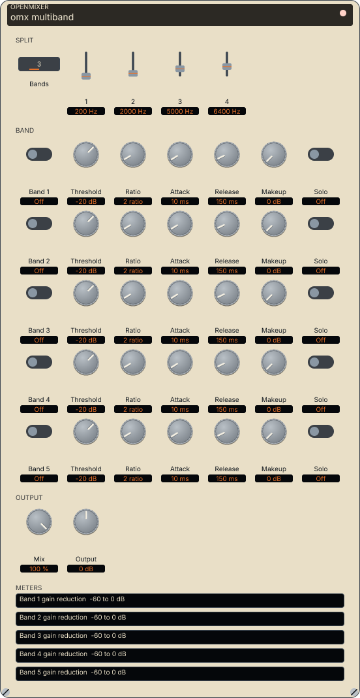

<!-- SPDX-License-Identifier: GPL-3.0-or-later -->
<!-- Copyright (C) 2026 Pau Aliagas <linuxnow@gmail.com> -->
<!-- Generated by tools/params-doc.mjs from the declarations; edit them and run `make params-doc`. -->

# omx multiband

A multiband compressor: two to five bands split by Linkwitz-Riley crossovers, each band its own compressor with threshold, ratio, attack, release, make-up, solo and bypass, then a mix and an output gain, for in-ear mixes, vocals and playback buses.

- CLAP id: `org.openmixer.multiband`
- LV2 URI: `urn:openmixer:multiband`
- Parameters: 42, plus the host's bypass

## Panel

The panel as a host draws it from the declaration alone, every control at its default (`make panel-images`: omx-panel lays it out and its renderer draws it). Its sections and their controls, in order:

| Section | Controls |
|---|---|
| Split | Bands, Crossover 1, Crossover 2, Crossover 3, Crossover 4 |
| Band 1 | Band 1 Threshold, Band 1 Ratio, Band 1 Attack, Band 1 Release, Band 1 Makeup, Band 1 Solo, Band 1 Bypass |
| Band 2 | Band 2 Threshold, Band 2 Ratio, Band 2 Attack, Band 2 Release, Band 2 Makeup, Band 2 Solo, Band 2 Bypass |
| Band 3 | Band 3 Threshold, Band 3 Ratio, Band 3 Attack, Band 3 Release, Band 3 Makeup, Band 3 Solo, Band 3 Bypass |
| Band 4 | Band 4 Threshold, Band 4 Ratio, Band 4 Attack, Band 4 Release, Band 4 Makeup, Band 4 Solo, Band 4 Bypass |
| Band 5 | Band 5 Threshold, Band 5 Ratio, Band 5 Attack, Band 5 Release, Band 5 Makeup, Band 5 Solo, Band 5 Bypass |
| Output | Mix, Output |

## Audio ports

| Direction | Name | Role | Channels |
|---|---|---|---|
| in | in | main | 2 (stereo) |
| out | out | main | 2 (stereo) |

## Pages

A page is where a host shows a parameter. In LV2 each page is a port group, `pg:group <urn:openmixer:multiband#<symbol>>`, whose `lv2:displayPriority` is the number below (a host that shows the higher first, as Zynthian does, shows the pages in port order). In CLAP each page is the module of its parameters (`clap_param_info.module`), the page labels joined by `/`.

| Page | LV2 group symbol | Priority | CLAP module | Parameters |
|---|---|---|---|---|
| Split | `split` | 7 | `Split` | 5 |
| Band 1 | `band1` | 6 | `Band 1` | 7 |
| Band 2 | `band2` | 5 | `Band 2` | 7 |
| Band 3 | `band3` | 4 | `Band 3` | 7 |
| Band 4 | `band4` | 3 | `Band 4` | 7 |
| Band 5 | `band5` | 2 | `Band 5` | 7 |
| Output | `output` | 1 | `Output` | 2 |

## Parameters

Ids are the order below, 0 to 41; a parameter appended later takes the next id. The bypass's id is its own (below).

| Id | Symbol | Name | Unit | Min | Max | Default | Step or values | Flags | Page (priority) |
|---|---|---|---|---|---|---|---|---|---|
| 0 | `bands` | Bands |  | 2 | 5 | 3 (3) | 2 2, 3 3, 4 4, 5 5 | automatable | Split (7) |
| 1 | `xoverHz1` | Crossover 1 | Hz | 40 | 16000 | 200 | whole steps | automatable | Split (7) |
| 2 | `xoverHz2` | Crossover 2 | Hz | 40 | 16000 | 2000 | whole steps | automatable | Split (7) |
| 3 | `xoverHz3` | Crossover 3 | Hz | 40 | 16000 | 5000 | whole steps | automatable | Split (7) |
| 4 | `xoverHz4` | Crossover 4 | Hz | 40 | 16000 | 6400 | whole steps | automatable | Split (7) |
| 5 | `thresholdDb1` | Band 1 Threshold | dB | -60 | 0 | -20 | continuous, linear | automatable | Band 1 (6) |
| 6 | `thresholdDb2` | Band 2 Threshold | dB | -60 | 0 | -20 | continuous, linear | automatable | Band 2 (5) |
| 7 | `thresholdDb3` | Band 3 Threshold | dB | -60 | 0 | -20 | continuous, linear | automatable | Band 3 (4) |
| 8 | `thresholdDb4` | Band 4 Threshold | dB | -60 | 0 | -20 | continuous, linear | automatable | Band 4 (3) |
| 9 | `thresholdDb5` | Band 5 Threshold | dB | -60 | 0 | -20 | continuous, linear | automatable | Band 5 (2) |
| 10 | `ratio1` | Band 1 Ratio | ratio | 1 | 20 | 2 | continuous, linear | automatable | Band 1 (6) |
| 11 | `ratio2` | Band 2 Ratio | ratio | 1 | 20 | 2 | continuous, linear | automatable | Band 2 (5) |
| 12 | `ratio3` | Band 3 Ratio | ratio | 1 | 20 | 2 | continuous, linear | automatable | Band 3 (4) |
| 13 | `ratio4` | Band 4 Ratio | ratio | 1 | 20 | 2 | continuous, linear | automatable | Band 4 (3) |
| 14 | `ratio5` | Band 5 Ratio | ratio | 1 | 20 | 2 | continuous, linear | automatable | Band 5 (2) |
| 15 | `attackMs1` | Band 1 Attack | ms | 0.1 | 200 | 10 | continuous, linear | automatable | Band 1 (6) |
| 16 | `attackMs2` | Band 2 Attack | ms | 0.1 | 200 | 10 | continuous, linear | automatable | Band 2 (5) |
| 17 | `attackMs3` | Band 3 Attack | ms | 0.1 | 200 | 10 | continuous, linear | automatable | Band 3 (4) |
| 18 | `attackMs4` | Band 4 Attack | ms | 0.1 | 200 | 10 | continuous, linear | automatable | Band 4 (3) |
| 19 | `attackMs5` | Band 5 Attack | ms | 0.1 | 200 | 10 | continuous, linear | automatable | Band 5 (2) |
| 20 | `releaseMs1` | Band 1 Release | ms | 10 | 2000 | 150 | whole steps | automatable | Band 1 (6) |
| 21 | `releaseMs2` | Band 2 Release | ms | 10 | 2000 | 150 | whole steps | automatable | Band 2 (5) |
| 22 | `releaseMs3` | Band 3 Release | ms | 10 | 2000 | 150 | whole steps | automatable | Band 3 (4) |
| 23 | `releaseMs4` | Band 4 Release | ms | 10 | 2000 | 150 | whole steps | automatable | Band 4 (3) |
| 24 | `releaseMs5` | Band 5 Release | ms | 10 | 2000 | 150 | whole steps | automatable | Band 5 (2) |
| 25 | `makeupDb1` | Band 1 Makeup | dB | 0 | 24 | 0 | continuous, linear | automatable | Band 1 (6) |
| 26 | `makeupDb2` | Band 2 Makeup | dB | 0 | 24 | 0 | continuous, linear | automatable | Band 2 (5) |
| 27 | `makeupDb3` | Band 3 Makeup | dB | 0 | 24 | 0 | continuous, linear | automatable | Band 3 (4) |
| 28 | `makeupDb4` | Band 4 Makeup | dB | 0 | 24 | 0 | continuous, linear | automatable | Band 4 (3) |
| 29 | `makeupDb5` | Band 5 Makeup | dB | 0 | 24 | 0 | continuous, linear | automatable | Band 5 (2) |
| 30 | `solo1` | Band 1 Solo |  | off | on | off | toggle | automatable | Band 1 (6) |
| 31 | `solo2` | Band 2 Solo |  | off | on | off | toggle | automatable | Band 2 (5) |
| 32 | `solo3` | Band 3 Solo |  | off | on | off | toggle | automatable | Band 3 (4) |
| 33 | `solo4` | Band 4 Solo |  | off | on | off | toggle | automatable | Band 4 (3) |
| 34 | `solo5` | Band 5 Solo |  | off | on | off | toggle | automatable | Band 5 (2) |
| 35 | `bandBypass1` | Band 1 Bypass |  | off | on | off | toggle | automatable | Band 1 (6) |
| 36 | `bandBypass2` | Band 2 Bypass |  | off | on | off | toggle | automatable | Band 2 (5) |
| 37 | `bandBypass3` | Band 3 Bypass |  | off | on | off | toggle | automatable | Band 3 (4) |
| 38 | `bandBypass4` | Band 4 Bypass |  | off | on | off | toggle | automatable | Band 4 (3) |
| 39 | `bandBypass5` | Band 5 Bypass |  | off | on | off | toggle | automatable | Band 5 (2) |
| 40 | `mixPct` | Mix | % | 0 | 100 | 100 | whole steps | automatable | Output (1) |
| 41 | `outputDb` | Output | dB | -24 | 24 | 0 | continuous, linear | automatable | Output (1) |

## Bypass

CLAP: the host's bypass, a parameter named Bypass at id 2147418112 (0x7FFF0000) in every plugin, flagged automatable, stepped and bypass; 0 is processing, 1 bypassed. The id never moves when a parameter is appended.
LV2: the port `enabled` (`lv2:designation lv2:enabled`) at index 0, 1 is processing, 0 is bypassed; the output port `latency` at index 1 reports the latency in frames. Both come before the audio and parameter ports in every plugin, so neither moves; a preset or a session names a port by its symbol.
