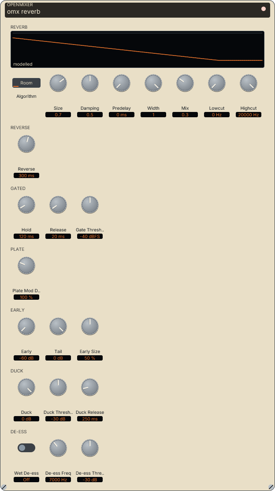

<!-- SPDX-License-Identifier: GPL-3.0-or-later -->
<!-- Copyright (C) 2026 Pau Aliagas <linuxnow@gmail.com> -->
<!-- Generated by tools/params-doc.mjs from the declarations; edit them and run `make params-doc`. -->

# omx reverb

The console's reverb: room, plate, hall, reverse and gated algorithms with pre-delay, size, damping, width and low and high cuts, mixed with the dry signal; the early reflections and the tail set apart, the wet ducked under the dry and de-essed in its band.

- CLAP id: `org.openmixer.reverb`
- LV2 URI: `urn:openmixer:reverb`
- Parameters: 22, plus the host's bypass

## Panel

The panel as a host draws it from the declaration alone, every control at its default (`make panel-images`: omx-panel lays it out and its renderer draws it). Its sections and their controls, in order:

| Section | Controls |
|---|---|
| Reverb | Algorithm, Size, Damping, Predelay, Width, Mix, Lowcut, Highcut |
| Reverse | Reverse |
| Gated | Hold, Release, Gate Threshold |
| Plate | Plate Mod Depth |
| Early | Early, Tail, Early Size |
| Duck | Duck, Duck Threshold, Duck Release |
| De-ess | Wet De-ess, De-ess Freq, De-ess Threshold |

## Audio ports

| Direction | Name | Role | Channels |
|---|---|---|---|
| in | in | main | 2 (stereo) |
| out | out | main | 2 (stereo) |

## Pages

A page is where a host shows a parameter. In LV2 each page is a port group, `pg:group <urn:openmixer:reverb#<symbol>>`, whose `lv2:displayPriority` is the number below (a host that shows the higher first, as Zynthian does, shows the pages in port order). In CLAP each page is the module of its parameters (`clap_param_info.module`), the page labels joined by `/`.

| Page | LV2 group symbol | Priority | CLAP module | Parameters |
|---|---|---|---|---|
| Plate | `plate` | 7 | `Plate` | 1 |
| Reverb | `reverb` | 6 | `Reverb` | 8 |
| Reverse | `reverse` | 5 | `Reverse` | 1 |
| Gated | `gated` | 4 | `Gated` | 3 |
| Early | `early` | 3 | `Early` | 3 |
| Duck | `duck` | 2 | `Duck` | 3 |
| De-ess | `deess` | 1 | `De-ess` | 3 |

## Parameters

Ids are the order below, 0 to 21; a parameter appended later takes the next id. The bypass's id is its own (below).

| Id | Symbol | Name | Unit | Min | Max | Default | Step or values | Flags | Page (priority) |
|---|---|---|---|---|---|---|---|---|---|
| 0 | `plateModDepth` | Plate Mod Depth | % | 0 | 400 | 100 | whole steps | automatable | Plate (7) |
| 1 | `mix` | Mix |  | 0 | 1 | 0.3 | continuous, linear | automatable | Reverb (6) |
| 2 | `size` | Size |  | 0 | 1 | 0.7 | continuous, linear | automatable | Reverb (6) |
| 3 | `damping` | Damping |  | 0 | 1 | 0.5 | continuous, linear | automatable | Reverb (6) |
| 4 | `width` | Width |  | 0 | 1 | 1 | continuous, linear | automatable | Reverb (6) |
| 5 | `predelay` | Predelay | ms | 0 | 100 | 0 | whole steps | automatable | Reverb (6) |
| 6 | `lowcut` | Lowcut | Hz | 0 | 20000 | 0 | whole steps | automatable | Reverb (6) |
| 7 | `highcut` | Highcut | Hz | 0 | 20000 | 20000 | whole steps | automatable | Reverb (6) |
| 8 | `reverse` | Reverse | ms | 50 | 500 | 300 | whole steps | automatable | Reverse (5) |
| 9 | `hold` | Hold | ms | 10 | 2000 | 120 | whole steps | automatable | Gated (4) |
| 10 | `release` | Release | ms | 1 | 500 | 20 | whole steps | automatable | Gated (4) |
| 11 | `gateThreshold` | Gate Threshold | dBFS | -80 | 0 | -40 | whole steps | automatable | Gated (4) |
| 12 | `algorithm` | Algorithm |  | 0 | 4 | Room (0) | 0 Room, 1 Plate, 2 Hall, 3 Reverse, 4 Gated | automatable | Reverb (6) |
| 13 | `earlyDb` | Early | dB | -60 | 0 | -60 | continuous, linear | automatable | Early (3) |
| 14 | `tailDb` | Tail | dB | -60 | 0 | 0 | continuous, linear | automatable | Early (3) |
| 15 | `earlySizePct` | Early Size | % | 0 | 100 | 50 | whole steps | automatable | Early (3) |
| 16 | `duckDb` | Duck | dB | -24 | 0 | 0 | continuous, linear | automatable | Duck (2) |
| 17 | `duckThresholdDb` | Duck Threshold | dB | -60 | 0 | -30 | whole steps | automatable | Duck (2) |
| 18 | `duckReleaseMs` | Duck Release | ms | 20 | 2000 | 250 | whole steps | automatable | Duck (2) |
| 19 | `wetDeess` | Wet De-ess |  | off | on | off | toggle | automatable | De-ess (1) |
| 20 | `deessFreqHz` | De-ess Freq | Hz | 2000 | 16000 | 7000 | whole steps | automatable | De-ess (1) |
| 21 | `deessThresholdDb` | De-ess Threshold | dB | -60 | 0 | -30 | continuous, linear | automatable | De-ess (1) |

## Bypass

CLAP: the host's bypass, a parameter named Bypass at id 2147418112 (0x7FFF0000) in every plugin, flagged automatable, stepped and bypass; 0 is processing, 1 bypassed. The id never moves when a parameter is appended.
LV2: the port `enabled` (`lv2:designation lv2:enabled`) at index 0, 1 is processing, 0 is bypassed; the output port `latency` at index 1 reports the latency in frames. Both come before the audio and parameter ports in every plugin, so neither moves; a preset or a session names a port by its symbol.
