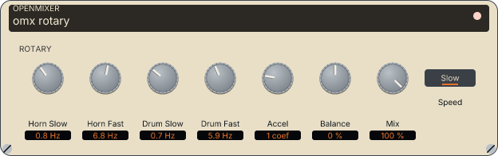

<!-- SPDX-License-Identifier: GPL-3.0-or-later -->
<!-- Copyright (C) 2026 Pau Aliagas <linuxnow@gmail.com> -->
<!-- Generated by tools/params-doc.mjs from the declarations; edit them and run `make params-doc`. -->

# omx rotary

The console's rotary speaker: a drum rotor on the low band and a horn rotor on the high band, with stop, slow and fast speeds, mixed with the dry signal.

- CLAP id: `org.openmixer.rotary`
- LV2 URI: `urn:openmixer:rotary`
- Parameters: 8, plus the host's bypass

## Panel

The panel as a host draws it from the declaration alone, every control at its default (`make panel-images`: omx-panel lays it out and its renderer draws it). Its sections and their controls, in order:

| Section | Controls |
|---|---|
| Rotary | Horn Slow, Horn Fast, Drum Slow, Drum Fast, Accel, Balance, Mix, Speed |

## Audio ports

| Direction | Name | Role | Channels |
|---|---|---|---|
| in | in | main | 2 (stereo) |
| out | out | main | 2 (stereo) |

## Pages

A page is where a host shows a parameter. In LV2 each page is a port group, `pg:group <urn:openmixer:rotary#<symbol>>`, whose `lv2:displayPriority` is the number below (a host that shows the higher first, as Zynthian does, shows the pages in port order). In CLAP each page is the module of its parameters (`clap_param_info.module`), the page labels joined by `/`.

| Page | LV2 group symbol | Priority | CLAP module | Parameters |
|---|---|---|---|---|
| Rotary | `rotary` | 1 | `Rotary` | 8 |

## Parameters

Ids are the order below, 0 to 7; a parameter appended later takes the next id. The bypass's id is its own (below).

| Id | Symbol | Name | Unit | Min | Max | Default | Step or values | Flags | Page (priority) |
|---|---|---|---|---|---|---|---|---|---|
| 0 | `hornSlowHz` | Horn Slow | Hz | 0.1 | 2 | 0.8 | continuous, log | automatable | Rotary (1) |
| 1 | `hornFastHz` | Horn Fast | Hz | 3 | 10 | 6.8 | continuous, log | automatable | Rotary (1) |
| 2 | `drumSlowHz` | Drum Slow | Hz | 0.1 | 2 | 0.7 | continuous, log | automatable | Rotary (1) |
| 3 | `drumFastHz` | Drum Fast | Hz | 3 | 10 | 5.9 | continuous, log | automatable | Rotary (1) |
| 4 | `accel` | Accel | coef | 0.25 | 4 | 1 | continuous, linear | automatable | Rotary (1) |
| 5 | `balance` | Balance | % | -100 | 100 | 0 | whole steps | automatable | Rotary (1) |
| 6 | `mix` | Mix | % | 0 | 100 | 100 | continuous, linear | automatable | Rotary (1) |
| 7 | `speed` | Speed |  | 0 | 2 | Slow (1) | 0 Stop, 1 Slow, 2 Fast | automatable | Rotary (1) |

## Bypass

CLAP: the host's bypass, a parameter named Bypass at id 2147418112 (0x7FFF0000) in every plugin, flagged automatable, stepped and bypass; 0 is processing, 1 bypassed. The id never moves when a parameter is appended.
LV2: the port `enabled` (`lv2:designation lv2:enabled`) at index 0, 1 is processing, 0 is bypassed; the output port `latency` at index 1 reports the latency in frames. Both come before the audio and parameter ports in every plugin, so neither moves; a preset or a session names a port by its symbol.
